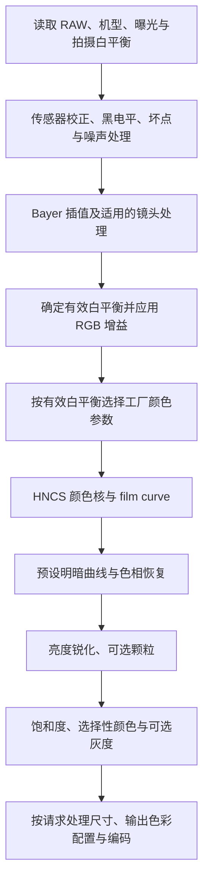

# Nature 完整处理流程与 iPhone 偏绿修复

2026-10-18，应用 render revision 11。使用 analyze-it 指定的 radare2 6.2.4 与 r2ghidra `pdg` 分析 Phocus 4.2.2 arm64；共核查 38 个函数，并直接调用原始程序库验证白平衡、曲线和颜色参数选择。手机测试遵照用户要求保持暂停；本文的照片验证全部使用此前保存的三摄 RAW。

## 先用人话解释

**Nature 是一包可以拆开的设置。** 包里有明暗曲线、锐化、白平衡等参数，它使用 Phocus 共用的处理流程。原始 Nature 包恰好保存了 **5500 K 和一个固定 Tint**，并不表示整个 Phocus 软件只能使用这个白平衡。

照片里的白色应该怎样还原，要看现场光线。白平衡同时处理冷暖方向和绿／洋红方向。iPhone 已经为每张照片做了这份现场校正；旧版 GlassCam 随后把 Nature 包里的固定白平衡也套上去，改变了这份校正。因此，在这次室内照片中，红、蓝相对绿色被压低，墙面就多了一层黄绿色。

Phocus 本身允许单独改白平衡。可以保留 Nature 的明暗和细节效果，把白平衡改回照片拍摄时的值。修复后的相机默认采用这个组合，并保留“Original preset”选项供明确需要原始整包白平衡时使用。

## 原版完整流程

以下是哈苏原生 RAW 主路径的功能顺序。RAW 类型、机型、局部调整、预览尺寸和 HDR 会选择不同分支；图中不表示所有分支每次都执行。

| 环节 | 原版行为及 Nature 的作用 | 主要二进制入口 |
|---|---|---|
| 读取照片与设置 | 读取相机／RAW 信息；完整预设载入和单工具载入是不同操作 | `LoadSetup`、`CImageSetting::UpdateFrom`、`DecodeToolFrom` |
| 原生 RAW 准备 | 传感器、黑电平、坏点、噪声、插值和镜头分支依赖实际 RAW | `AddBaseFilters`、`AddSingleshotRawFilters`、`AddRGBFilters` |
| 白平衡选择 | 温度为 0 表示 As Shot；非零值使用设置里的温度与 Tint | `HandleAsShot`、`UpdateProcessParams` |
| 白平衡运算 | 按机型和 IR 类型把温度／Tint 转成 RGB 增益；也可直接采用 RAW 的 As Shot 增益 | `CColorTempConversion`、`CWhiteBalanceFilter` |
| 颜色校正 | 从**有效**白平衡增益反求 CCT，交给颜色校正工厂选择矩阵／LUT | `CColorCorrectFilter` → `GainToTempAndTint` → `NewRawColorCorrection` |
| 明暗与细节 | film curve 后接 gradation／RecoverHue，再做亮度锐化和可选颗粒 | `AddPostViewerRGBFilters` |
| 后置颜色及输出 | 饱和度／选择性颜色、灰度，随后输出配置转换等 | `AddPostViewerRGBFilters`、`AddOutputFiltersExport`、`ProcessCropSpecific` |

Nature 文件里的主要参数如下；这些原始资产没有被修改：

| 项目 | 原始值 | 实际意义 |
|---|---|---|
| ColorTemperature / Tint | 5500 / −0.003333333333333333 | 固定白平衡；Tint 是 Phocus 内部单位 |
| Gradations 的主曲线控制点 | (0,0)、(71,31)、(184,223)、(255,255) | 压暗较暗部分、提亮较亮部分，形成更强的明暗反差 |
| Contrast / Saturation | 0 / 0 | Nature 的反差主要来自上述曲线；不能把所有效果理解成增加饱和度 |
| FilmCurve | 4，即 As Shot | 哈苏 RAW 可提供实际类型；本 App 对缺少该元数据的 Apple 输入继续明确使用 type 2 |
| Gamma | 2，原生解码后有效 gamma 为 1 | XML 数值不能直接作为一遍额外 gamma 运算 |
| USMAmount / Radius | 180 / 8 | 原版亮度锐化；半径参数进入滤镜前除以 10，强度还受 RAW BaselineSharpness 影响 |
| ApplyFilmGrain | false | 此 Nature 配置不添加颗粒 |
| ColorModel | 0 | 标准颜色模式；不是 reproduction |

原版锐化、色相恢复和后置颜色的数值细节，复用已经完成的[可读反编译与原生验证](PHOCUS_READABLE_ANALYSIS_20261018.md)。这些是指定处理阶段的验证，不等于完整 RAW 显影和最终成片的跨相机等价。

## 白平衡分支到底做了什么

完整载入 Nature 时，`CSetupHandler::LoadSetup` 复制完整设置，再调用 RAW 的修正规则与 `HandleAsShot`。后者在温度非 0 时直接返回。因此，Nature 的 5500 K 不会自动变成当前照片的白平衡。

温度为 0 时，`HandleAsShot` 读取照片的 As Shot 温度／Tint；读不到时有 5000 K、Tint 0 的回退。底层 `CCameraImage::UpdateProcessParams` 也有独立分支：有 RAW 且温度为 0，读取其 As Shot 增益；否则调用 `TempAndTintToGain`。这说明“原厂始终固定白平衡”和“完整 Nature 自动保留现场白平衡”都不能作为原版行为的描述。

白平衡在设置里也是独立工具：`DecodeToolFrom` 的 tool 7 只更新 part 9，即 correction 对象的温度 `0x27c` 与 Tint `0x280`。本次直接执行原始函数，把 Nature 的白平衡替换为 Standard 的 As Shot 设置，结果为：

- 温度由 5500 变为 0，Tint 变为 0。
- correction 对象中其他字节没有变化。
- 重新调用原始 `CCalculatedCurves` 后，五张 65,536 项曲线表共 **327,680 项全部不变**。

颜色核参数也必须与有效白平衡一起选择。`CColorCorrectFilter` 在 `0x23a08` 调用增益→温度换算，随后读取换算结果，在 `0x23a3c` 传入 `NewRawColorCorrection`。这段还核对了汇编，避免把反编译器显示的初始 5000 常量误认成固定工厂色温。

原版直接构造验证覆盖主摄／长焦／超广的虚拟白点，以及暖光、D65、绿／洋红偏移，共 7 个白点 × 2 种白平衡选择 × 2 个工作空间，**28 组矩阵及 LUT 完全匹配**。使用同一选择创建修复后的 C++ context，再与原版颜色核比较 **688,128 个 UInt16 通道，最大差为 0**。

## Apple RAW 路径与移植范围

Phocus 为 Apple 支持的 RAW 提供单独的 `CRawImageFileMac` 路径。反编译直接显示它调用 Apple 的 `filterWithImageURL:options:`，读取 `kCIInputNeutralTemperatureKey` 和 `kCIInputNeutralTintKey`，保存为 As Shot 显示值。其 `ApplyCorrectionsFilter` 重置部分噪声、镜头、场景、颜色管理与局部调整设置；其中 `0x91` 是 **ApplyCM**，不能误写成关闭 HNCS 的 ApplyCC。

这意味着不能把“原厂 HNCS 颜色核已验证”扩展成“iPhone RAW 前处理与哈苏 RAW 相同”。GlassCam 仍使用 Apple 解码器处理 iPhone RAW，然后通过已有虚拟 X2D 适配进入验证过的颜色阶段。这个适配是模型，没有变成经过对拍标定的 iPhone→X2D 相机配置。

修复保留 Apple 读出的完整 xy 白点。色温与 Tint 用于展示；完整 xy 同时包含冷暖和绿／洋红方向的信息。Apple Tint 与 Phocus Tint 的单位不同，不能直接复制或相减。

## 这次偏绿的可计算原因

以已拍长焦照片为例，Apple 白点是 `(0.3356719315, 0.3742703199)`，约 5393 K。通过现有虚拟响应计算：

| 参数 | R | G | B |
|---|---:|---:|---:|
| 虚拟拍摄增益 | 2.908741 | 1 | 1.923911 |
| 原始 Nature 目标增益 | 2.711552 | 1 | 1.690108 |
| 目标／拍摄 | 0.932208 | 1 | 0.878475 |

进入颜色核前，中性输入的红蓝因此相对减少。这里的向量属于虚拟 X2D 模型，不是直接测量的 iPhone 传感器增益；比例也不是最终 HEIF 的逐通道乘数。

同一个 18% 合成中性灰、同样的 Nature/L* 配置、额外曝光 0 EV：修复前线性 RGB 为 **[0.260487, 0.336481, 0.231707]**，修复后为 **[0.308459, 0.309248, 0.312007]**。原先显著高出的绿色恢复到接近中性；Nature 的明暗变化仍然存在。

主摄现场约 5519 K，与 Nature 的 5500 K 很接近，仍发生偏绿。这正好说明仅比较 Kelvin 数字不够，还要保留现场的绿／洋红补偿。

## 修复内容与兼容性

新增 `hncs_create_preset_whitepoint_with_policy`，在旧 API 之外显式选择白平衡：

| 选择 | 目标白平衡增益 | 默认颜色核 CCT | 适用情况 |
|---|---|---|---|
| Photo · Automatic，新的相机默认 | 等于当前照片的虚拟拍摄增益 | 从同一照片白点得到的 CCT | 保留现场白平衡，应用 Nature 的其他效果 |
| Original preset | 沿用原始预设目标增益；无固定 WB 时保留照片值 | 原始预设 CCT 或照片 CCT | 重放完整原始预设行为 |

明确设置的 factory CCT override 继续优先，只改变颜色配置选择。原始曲线、LUT、工厂增益、锐化和颜色核公式均保留；没有加入按场景猜测的“减绿色”系数。

`HNCSSettings` 升级为 revision 11，白平衡选择进入持久配方和缓存身份。旧相机**偏好设置**只为未来照片迁移到 Photo，保留其他已选效果；旧**待恢复照片配方**缺少这个字段时继续按 Original preset 重放。用户明确选择的任一种策略在重启后都保留。成片页也区分 `Auto WB` 与 `Preset WB`。

Daylight、Cloudy 等以白平衡为主要作用的预设，在 Photo 模式下同样不覆盖现场值；设置页明确显示该预设的固定色温未应用，需要其固定照明效果时选择 Original preset。

## 已有照片验证与交付状态

主摄、长焦、超广各使用同一份已保存 RAW 和原配方，只切换白平衡策略。每支镜头分别生成修复前／后完整 HEIF，合计 **6 张 6048×8064、10-bit HDR**；全部通过回读、白点冻结和超白高光保留检查。主摄／长焦的旧模式 PNG 与修复前诊断 PNG 逐像素最大差为 **0**。

下表在 Apple 解码源上选定同一批低彩度像素，比较完整 HEIF 的绿色／红蓝均值比。它是同源相对比较，墙面没有被当作标定灰卡，数值不能当作绝对色差。

| 镜头 | 原始 Nature WB | Photo WB + Nature |
|---|---:|---:|
| 主摄 | 1.077574 | 1.007023 |
| 长焦 | 1.175379 | 1.032025 |
| 超广 | 1.106103 | 1.015029 |

图片是供并排查看的 SDR 缩略图，原始 HDR HEIF 路径保存在验证记录中。

- 209 项 Python 回归通过。
- Mac 生产 Swift／Core Image／Metal／HEIF 检查通过，含旧配方迁移、明确选择记忆、Nature 偏绿回归、旧持久任务恢复、HDR、输出插值、保存重试和分享。相机与 Photos 事务在这组测试中使用替身。
- iOS 通用设备 Release 编译通过，保留已有 SDK 弃用与方向配置警告。
- **新版未安装到手机，未恢复拍摄或手机测试。** 手机上现有包仍为修复前版本。本轮不能替代后续真机视觉、三摄切换与完整日常验收，也不扩大跨相机色彩等价声明。

完整路径、SHA-256、二进制函数清单、数值和日志见[结构化验证记录](../validation/nature-pipeline-20261018.json)。[原版白平衡探针](../tools/audit_phocus_white_balance.py)与[已有 RAW 全源对照程序](../tools/nature_white_balance_study.swift)均可重复执行；实际编译命令保存在证据目录的 `study-build-command.json`。
