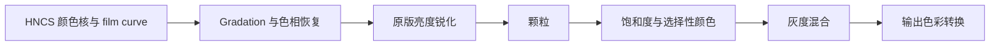

# Phocus 处理逻辑：可读反编译核查

2026-10-18。使用 `analyze-it` 指定的 **radare2 6.2.4 + r2ghidra `pdg`**，从哈希锁定的 Phocus 4.2.2 arm64 程序库生成 18 份 C 风格反编译。小函数补入经过原生调用验证的参数类型和名称；复杂 C++ 函数保留工具的类型推断与警告。

这里的代码块是便于阅读的语义说明。精确浮点操作顺序、FMA、截断和类型转换以生产实现及原版数值验证为依据。反编译中的自动类型、未恢复的间接调用不能单独作为数值正确的证明。

可复现工具：[decompile_phocus.py](../tools/decompile_phocus.py)。[完整反编译清单与常量](/Users/vonequinox/.codex/visualizations/2026/10/17/01a14ab5-2375-7d73-8f2d-7c765f31a874/phocus-completion-20261018/readable-c/manifest.json)记录原始库、arm64 切片、每个输出文件的 SHA-256，以及实际 r2 命令。

## 1. 原版的处理顺序

`AddPostViewerRGBFilters` 的可读结果明确给出：



本轮修复了旧实现把饱和度放在 gradation 前、把灰度放在锐化前的问题。生产入口现在按上述顺序分成“颜色核／曲线 → 全图空间处理 → 后置颜色”。当前工厂目录没有选择性控制点和 vibrance；全局饱和度、灰度已直接对照原版验证。颗粒仍是原先的便携模型，其随机内核不在原版等价声明内。

[查看原版调用顺序的 C 反编译](/Users/vonequinox/.codex/visualizations/2026/10/17/01a14ab5-2375-7d73-8f2d-7c765f31a874/phocus-completion-20261018/readable-c/AddPostViewerRGBFilters.c)。

## 2. `radius=None` 的原因与正确规则

`None` 来自只含某一工具参数的 XML，例如 Cloudy 只设置白平衡。GlassCam 已有的无状态预设约定是把这类工具预设叠加在原厂 Standard 上，因此锐化字段应来自 Standard。完整 `ImageCorrection` 则独立解码。

```cpp
// GlassCam 的无状态预设组合策略；完整设置与局部工具分开处理。
payload = xml.contains("ImageSetting")
    ? xml["ImageSetting"]["ImageCorrection"]
    : overlay(original_standard_xml, xml);
settings = original_Phocus_decode(payload);
```

原生 getter 和反编译确认了下面几种不同情况：

| 情况 | Amount | XML Radius | DarkLimit | NoiseLimit | ApplyUSM |
|---|---:|---:|---:|---:|---|
| 调用 `SetDefaultSharpness` | 0 | 10 | 10 | 0 | true |
| 解码一个空配置字典 | 0 | 0 | 0 | 0 | true |
| 原厂 Standard | 100 | 10 | 10 | 0 | true |
| 原厂 Nature | 180 | 8 | 10 | 0 | true |
| Cloudy 叠加在 Standard 上 | 100 | 10 | 10 | 0 | true |
| 完整 Standard 配置删除 Radius 字段 | 100 | 0 | 10 | 0 | true |

`DecodePartFrom` 直接读取数值键；缺失数值键返回 0。只有 `ApplyUSM` 的缺失分支明确采用 true。因此，不能给所有 `None` 统一填 10，也不能把缺失 Amount 一律变成关闭锐化。XML Radius 在加入滤镜时除以 10。

[默认初始化](/Users/vonequinox/.codex/visualizations/2026/10/17/01a14ab5-2375-7d73-8f2d-7c765f31a874/phocus-completion-20261018/readable-c/SetDefaultSharpness.c) · [配置解码，case 4](/Users/vonequinox/.codex/visualizations/2026/10/17/01a14ab5-2375-7d73-8f2d-7c765f31a874/phocus-completion-20261018/readable-c/DecodePartFrom.c)。56 个预设键（含别名）、8 组缺失字段／开关案例均与原生 getter 一致。

## 3. RAW 如何影响实际锐化强度

给反编译器补入真实签名后，可以直接读到 `baseline`、`compensation` 的用途。`1.8` 与 `1000.0` 均由 r2 从同一个二进制切片读取。

```cpp
double effective_amount(int preset_amount, double baseline, int compensation) {
    double amount = preset_amount + max(compensation - 100, 0);
    if (baseline <= 0) return amount;
    double gain = baseline * 1.8;
    if (amount <= 100) return amount * gain;
    double factor = (10.0 - gain) / 9.0;
    return fma(-factor, 1000.0, fma(factor, amount, 1000.0));
}
```

| 预设 | XML 强度 | RAW BaselineSharpness | 有效强度 | 进入内核的整数 |
|---|---:|---:|---:|---:|
| Standard | 100 | 1.5 | 270 | 270 |
| Nature | 180 | 1.5 | 334.88888888888886 | 334 |

进入滤镜前向零截断。当前 iPhone DNG 以及三个已有哈苏 RAW 的 BaselineSharpness 均为 1.5；应用从每张 RAW 读取并冻结这个值。原版 `GetBaselineSharpness` 在读不到字段时返回 0。本轮没有合成未知的镜头或局部锐化补偿。

[带真实参数名的强度函数](/Users/vonequinox/.codex/visualizations/2026/10/17/01a14ab5-2375-7d73-8f2d-7c765f31a874/phocus-completion-20261018/readable-c/EffectiveSharpnessAmount.c) · [RAW 字段读取](/Users/vonequinox/.codex/visualizations/2026/10/17/01a14ab5-2375-7d73-8f2d-7c765f31a874/phocus-completion-20261018/readable-c/GetBaselineSharpness.c)。

## 4. 锐化处理的是亮度

```cpp
rgb14 = rgb16 >> 2;
luma = (299 * rgb14.r + 587 * rgb14.g + 114 * rgb14.b) / 1000;
horizontal = integer_horizontal_filter(luma); // 此处已整除截断
blurred = integer_vertical_filter(horizontal); // 再次整除截断
detail = luma - blurred;
delta = signed_int32(detail * amount_table[luma] * noise_table[abs(detail)]) / 25500;
output = clamp(rgb14 + same_delta_for_all_channels, 0, 16383) << 2;
```

原版给 RGB 加同一个修正量；旧的逐通道 Gaussian USM 会在彩色边缘改变不同通道之间的关系。暗部与噪声表、14 位内部工作码、整数乘法行为、两次整除也都是原版算法的一部分。

原版 `CRepeatMarginFilter` 在 RGB 路径重复边缘像素。数值对比直接用这个原生滤镜准备邻域，覆盖单像素、单行、单列、角点，以及 32／64 行、4096 列分块附近。

[强度表](/Users/vonequinox/.codex/visualizations/2026/10/17/01a14ab5-2375-7d73-8f2d-7c765f31a874/phocus-completion-20261018/readable-c/AmountTable.c) · [噪声表](/Users/vonequinox/.codex/visualizations/2026/10/17/01a14ab5-2375-7d73-8f2d-7c765f31a874/phocus-completion-20261018/readable-c/NoiseTable.c) · [边界处理](/Users/vonequinox/.codex/visualizations/2026/10/17/01a14ab5-2375-7d73-8f2d-7c765f31a874/phocus-completion-20261018/readable-c/RepeatMargin.c)。

## 5. 饱和度和灰度的数值约定

全局饱和度使用原版 HSL 路径。输入工作码除以 **65536**，按原版 Float／Double 边界转换，调节饱和度后回到 RGB，乘 **65535** 并截断。旧实现采用围绕 RGB 均值缩放的近似。本轮保留原版 HSL 的阈值、FMA、量化与调用位置。

灰度混合在锐化之后执行，使用原版双精度加权、FMA、向下取整与裁切。当前工厂红／绿／蓝滤镜分别保留对应通道。

[饱和度](/Users/vonequinox/.codex/visualizations/2026/10/17/01a14ab5-2375-7d73-8f2d-7c765f31a874/phocus-completion-20261018/readable-c/Saturation.c) · [RGB → HSL](/Users/vonequinox/.codex/visualizations/2026/10/17/01a14ab5-2375-7d73-8f2d-7c765f31a874/phocus-completion-20261018/readable-c/RGBToHSL.c) · [灰度](/Users/vonequinox/.codex/visualizations/2026/10/17/01a14ab5-2375-7d73-8f2d-7c765f31a874/phocus-completion-20261018/readable-c/Grayscale.c)。约 3,386 万个后置颜色通道与原版零差异。

## 6. 曝光、缩放与 HDR 的边界

`GetIsoGain` 的反编译显示多个按机型、数据来源和调试选项选择的分支。在本轮三个已有哈苏 RAW 所用的分支，原生 getter 与下式完全一致：

```text
code_gain = 65535 / (WhiteLevel - BlackLevel)
            × 2^(BaselineExposure + BaselineExposureOffset)
```

这包含 RAW 码值范围的归一化，不能再次整体乘到 Apple 已归一化的 RGB 上。该公式的验证范围是所列文件及其原生分支，不是所有 RAW 文件。原厂预设的 `EV=1` 是倍率 1，即额外 0 EV。

`RadiusScaleCorrection` 还明确表明原版缩小预览有单独的半径补偿；HDR 分支会传入独立的工作域系数 **5.8829245141**。它们不能从参数名称直接解释为 iPhone 的曝光补偿。当前原版数值等价的范围是 **全分辨率、非 HDR 工作码、无局部／镜头补偿**。应用的 HDR 幅值分离与恢复属于外层适配，由实际 Core Image／HEIF 回读检查验证；没有把它宣称为 Phocus 完整 HDR 引擎。

应用最终成片预览直接读取最终 HEIF，因此包含完整源尺寸的锐化。缩小 RAW 的诊断预览复用解码配方和 RAW 元数据；不同采样尺寸的空间效果不具有逐像素等价性。

[曝光增益的分支](/Users/vonequinox/.codex/visualizations/2026/10/17/01a14ab5-2375-7d73-8f2d-7c765f31a874/phocus-completion-20261018/readable-c/GetIsoGain.c) · [预览缩放补偿](/Users/vonequinox/.codex/visualizations/2026/10/17/01a14ab5-2375-7d73-8f2d-7c765f31a874/phocus-completion-20261018/readable-c/RadiusScaleCorrection.c)。

## 7. 如何判断结论是否可靠

| 证据 | 可以确认的内容 |
|---|---|
| r2ghidra C 反编译、参数类型和二进制常量 | 默认值、条件分支、参数用途、调用顺序 |
| 原始 Phocus getter／滤镜直接调用 | 相同输入下真实输出，避免只与自己的参考实现互证 |
| 不同随机种子、O0／O3 构建、边界与整条流水线比较 | 修正的数值稳定性及串联一致性 |
| Mac 上实际 Swift／Core Image／Metal／HEIF | RAW 参数传递、HDR、编码、预览和导出的应用集成 |

两轮颜色核／曲线检查合计 **203,709,420 个通道，最大 UInt16 差为 0**；白平衡增益最大误差约 `1.33e-15`。整条颜色／锐化／后置颜色流水线另有 712 组检查、4,949,196 个通道为零差异。后续验收与 Git 检查点见 [revision 10 交付报告](PHOCUS_REVISION10_20261018.md)。

这些证据确认的是指定输入域和处理阶段的数值正确性。虚拟 iPhone→X2D 输入映射、Apple 已有显影及真实跨相机观感仍有独立边界；没有受控对拍时，不宣称全场景色差为零。

## 复现可读反编译

在 `GlassCamPrototype/` 中执行，输出目录置于源码仓库之外：

```sh
python3 -B tools/decompile_phocus.py --output-dir /tmp/phocus-readable
```

需要本机 `r2`、r2ghidra 的 `pdg` 和 Xcode 的 `lipo`。工具逐项核验 Phocus 原始库 SHA-256，保存原始 C 输出、警告和精确常量，不修改原程序。
