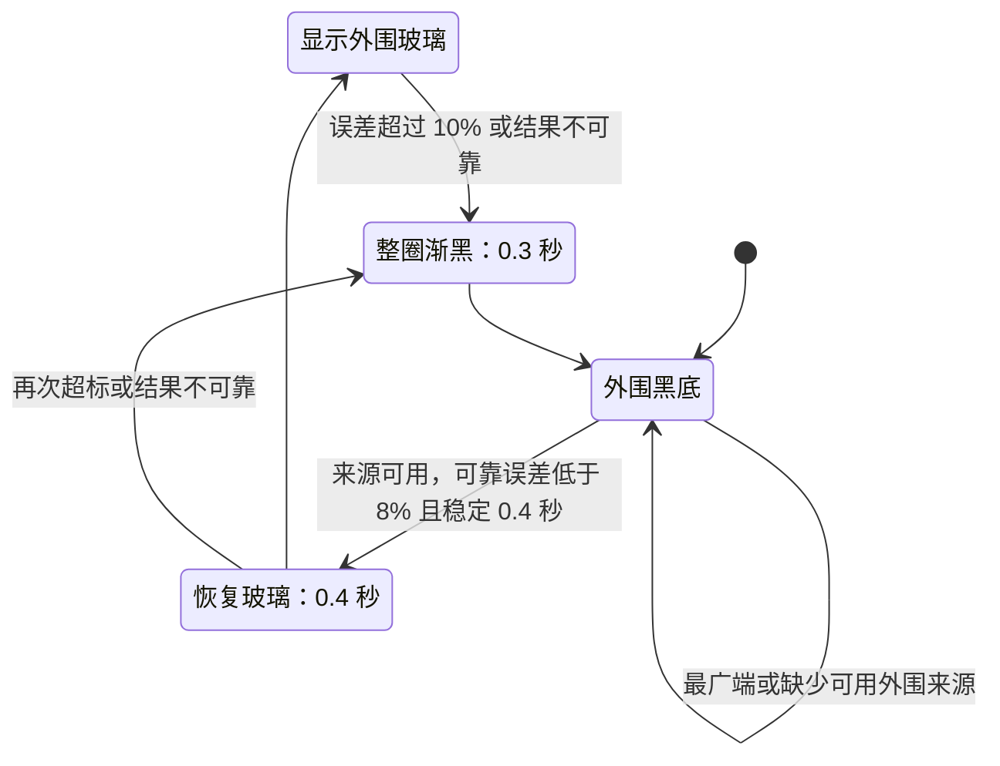

# GlassCam 取景与设置 UI 重写：最终设计约定

> **2026-10-22 更新**：沿用双路图像匹配，整体配准与接缝跟踪分频；保留真实框外搜索余量，只验证实际外围相邻的边界，并为分析亮度去除细噪声；刷新配准时比较同一帧的新旧接缝质量。孤立弱点最多保留 200 ms，按测量时间滤波。5%→10% 映射及 8% 恢复门槛保留。此前版本安装后仍不稳定，最新已离线修正相关峰误判，未安装，见[运动诊断](MOTION_INSTABILITY_20261022.md)。用户禁止手机调试后未再访问手机。此前实现和安装记录见[双摄稳定性与会话修复](PERIPHERAL_STABILITY_20261022.md)。

> **2026-10-20 更新（用户确认，替代下文冲突条目）**
>
> - 外围材质改用系统 Liquid Glass：`PeripheralLiquidGlass` 以 `.glassEffect(.clear)` 精确覆盖 `CameraFraming.perimeter`（竖屏即上下两块），中央成像区不放玻璃。下文“禁用官方 Liquid Glass”与自定义雾化／折射／边缘高光作废。
> - Metal 层只负责真实外围：对齐后的超广角画面单次双线性采样、不模糊、亮度与中央匹配，再按黑化程度混向不透明黑；黑底上的 clear 玻璃即“黑色玻璃”。中央 fragment 丢弃不变。
> - 黑化改为随畸变连续变化：接缝残差 ≤5% 透明，5%→10% 按 smoothstep 加深，10% 达到不透明黑；超过 10% 或不可靠时锁定黑色，残差 <8% 且稳定 0.4 秒后解锁并回到映射值。动画为恒速：满程变暗 0.3 秒、变亮 0.4 秒。不在界面显示数值。
> - 取景目标 60 Hz：双摄按 60→30→15 fps 依次尝试，60 不可行时保留真实外围降到 30（用户确认）；单摄预览图在格式支持时锁 60 fps，拍摄图不受影响；外围 MTKView 与实验实时色彩均为 60 Hz。
> - 取景面板改用系统玻璃 sheet；取景胶囊按钮减轻填充，控件加柔和阴影以保证 clear 玻璃上的可读性。独立全屏设置页样式未改。

日期：2026-10-19。实施基于当前 `main`。设计问题 Q1–Q16 已回答，用户已整体确认并授权实施。代码完成后，用户要求安装到 USB 连接的 iPhone；签名 Release 构建及覆盖安装已完成，本次未启动手机 App 或执行 UI 测试。UI／拍摄验收仍需新的许可。

## 设计树

```text
UI 重写
├─ 成像范围
│  ├─ 中央最大等比、固定居中：横屏 4:3，竖屏 3:4
│  ├─ 新拍摄移除 Square Crop
│  └─ 单颗实际镜头 RAW 成片，与中央预览构图一致
├─ 外围来源
│  ├─ 有合适较广镜头：真实多摄外围，进行对齐与质量判断
│  ├─ 最广端：中央正常取景，外围黑底
│  └─ 不做补外围的裁切回退；玻璃延展方案不采用
├─ 外围玻璃
│  ├─ 自定义材质；禁用官方 Liquid Glass
│  ├─ 中央完全排除在玻璃作用范围之外
│  └─ 误差超标或无法可靠估计：整圈渐黑，稳定后恢复
└─ 操作界面
   ├─ 常驻控件、进度与提示在外围
   ├─ 取景快捷项：镜头、风格、24/48MP
   ├─ 独立全屏设置：常用卡片＋高级二级页面
   └─ 跟随系统的中文／英文；预设保留原名
```

## 成像区与照片

- 中央成像区沿用现有最大等比、严格居中的布局，不为控件缩小。横屏 4:3，竖屏 3:4。
- 新拍摄移除 `Square Crop` 选择及其方形裁切；已有待恢复照片保留拍摄时的配方，旧相机偏好进行兼容迁移。
- 多摄融合只用于取景补全，最终照片继续来自一颗实际拍摄镜头的 RAW，中央预览与最终构图对应。
- 保留现有 HNCS／FFCS、照片白平衡、HDR、24MP／48MP 输出政策、自动保存、回看与恢复能力。
- 不为了填满外围改变实际拍摄镜头、中央构图或成片裁切。现有用户主动变焦与系统自动选镜继续保留。

## 外围来源和黑化

- 正常情况下使用真实较广镜头补充外围，并先完成对齐，再施加玻璃材质。
- 最广端没有更广来源时，外围直接使用黑底，中央正常显示。
- 本轮取消补外围的单摄裁切回退，也不采用虚构框外视野的图像延展。
- 误差定义：两路画面对齐后，接缝附近对应物体的屏幕位置残差，除以屏幕短边。30 cm 是观看验收距离。
- 10% 是用户确定的黑化触发线，不把“低于 10%”本身作为已经证明视觉无缝的结论；实际接缝效果需要真机验收。

| 状态／条件 | 外围行为 |
|---|---|
| 可靠对齐，未触发黑化 | 显示真实外围和自定义玻璃 |
| 误差超过 10% | 整个外围在约 0.3 秒内同步变为完全不透明的黑底 |
| 无法可靠估计误差，包括掉帧、遮挡或缺少有效匹配 | 同样渐黑，不能把未知误差当成零 |
| 黑化后，可靠误差低于 8% 且连续稳定约 0.4 秒 | 用约 0.4 秒恢复玻璃 |
| 最广端没有更广来源 | 保持黑底 |

动画表现为玻璃透光程度连续变化。中央构图、位置、亮度和清晰度不随玻璃动画改变；外围按钮和文字保持可见。恢复期间再次满足黑化条件时，从当前视觉状态连续转向黑底，避免跳帧。



## 自定义玻璃

- 不使用官方 `glassEffect`／`UIGlassEffect` 作为本次取景和设置的玻璃实现。
- 参考 [Pixelux-Glass](https://github.com/CruzCortes/Pixelux-Glass/tree/716790ef00968046641790619ce145884b8a8ba1) 的相机纹理直连思路，以及 [liquid-shader](https://github.com/horita-yuya/liquid-shader/tree/b77f09ae38d2e75d671304fcf694b598805662db) 的折射算法，采用适合现有相机流的自定义 Metal 材质。
- 两个参考都不是可直接接入的多摄拼接库；相机格式、色彩信息、横竖屏映射和同步需按当前工程适配。若复用代码，保留对应许可证和来源。
- 允许外围渐变雾化、轻微折射和亮度压低。材质覆盖区严格为“窗口减中央成像区”；模糊、边缘高光与抗锯齿也不得侵入中央。
- 不依靠每帧截图整个 SwiftUI 界面生成相机玻璃。
- 以同一输入帧、相同显示条件下的开关对照，验证玻璃不会让中央提亮、变色或模糊。

## 取景和设置布局

- 正常取景时中央只保留可关闭的网格；玻璃边界与克制的角标明确标示成像区。
- 常驻控件、拍摄／处理进度和简短提示放到外围。详细错误处理通过操作面板展开。
- 取景可直接操作镜头倍率、风格、24MP／48MP；保留快门、最近照片和设置入口。
- 设置使用独立全屏页面。常用设置按卡片分组，高级参数进入二级页面。
- 工厂色温、工作色域、渲染意图、LUT 表族等参数放到高级层；重组界面时保留用户已有设置。
- 新界面跟随系统提供中文与英文。Nature、PROVIA 等预设名称保留原名。
- 适配现有横竖屏与可用窗口尺寸；控件服从固定成像区，空间不足时使用独立操作面板。

## 实现与验收

1. 实现固定成像区、取景控件、分层设置、本地化及 Square Crop 的兼容迁移。
2. 接入真实外围视频、同步与对齐质量判断，保持原有高分辨率拍摄和恢复流程。
3. 实现自定义外围玻璃与上述完整黑化／恢复状态机。
4. 检查同帧中央像素、阈值进出、无可靠数据、最广端、横竖屏和状态切换。
5. 完成现有照片处理回归及 iOS Release 构建，再进行真实设备上的接缝、动画、拍摄与恢复验收。

以上为已批准的设计约定。当前实现和未验证边界见下方记录；历史构建与设备证据不能作为本版通过验收的依据。


## 当前代码交付

代码已写入 `main` 工作区。最终源码已与 HNCS revision 12 一同通过签名 Release 构建、严格签名校验及 USB 覆盖安装；本次未启动手机 App、执行 UI 测试或拍摄照片。见[初次安装记录](../validation/iphone-install-revision12-20261019.json)；后续元数据修正版安装见[故障记录](METADATA_FAILURE_20261019.md)，其 Mac 定向检查不验证 UI。此前 209 项回归和设备记录仅对应历史版本，不能证明本次运行效果。

| 部分 | 实现位置 | 行为 |
|---|---|---|
| 取景与导航 | [CameraView.swift](../ios/GlassCam/CameraView.swift) | 固定成像区，外围快捷操作、状态与角标，紧凑布局和独立控制面板 |
| 设置样式 | [CameraDesign.swift](../ios/GlassCam/CameraDesign.swift) | 自定义卡片、按钮、页头与渐变背景；常用和高级页面共享原有设置 |
| 相机图 | [CameraController.swift](../ios/GlassCam/CameraController.swift) | 虚拟相机原生中心端口和更广的 constituent 端口；拍摄时释放预览图，再建实际物理镜头的 `.photo` 图 |
| 同步与对齐 | [PeripheralAlignment.swift](../ios/GlassCam/PeripheralAlignment.swift) | 有界帧对、Vision 单应性、变换后的接缝残差和颜色增益 |
| 玻璃与动画 | [PeripheralGlassView.swift](../ios/GlassCam/PeripheralGlassView.swift)、[Shader](../ios/GlassCam/PeripheralGlassShader.swift)、[Policy](../ios/GlassCam/PeripheralGlassPolicy.swift) | RGBA16Float 外围材质，中央 fragment 丢弃，完整黑化及恢复状态机 |
| 兼容与语言 | [CameraSettingsStore.swift](../ios/GlassCam/CameraSettingsStore.swift)、[Localizable.xcstrings](../ios/GlassCam/Localizable.xcstrings) | 旧相机 Square Crop 偏好迁移到 Standard；旧照片配方仍支持原始裁切；常用与高级控件中英文本地化 |

### 相机和外围边界

1. 先用普通 `.photo` 图确认相机能力与中心帧，再尝试单个虚拟三摄输入的三路视频输出（原生中心、超广、主摄）。失败时尝试中心加超广两路，再不可用则恢复普通中心预览并保持黑色外围。
2. 选择实际可连接的端口、同画幅及匹配 FOV 的视频格式；配置 30 fps，并在输入加入图之后设置帧率预算。硬件及压力成本均需合格。外围帧缺失不阻止中心有效帧交付。
3. 主摄通常选超广作外围；长焦优先用主摄，缺少该路时尝试超广。实际中心为超广时没有更广来源，外围保持黑色。外围必须覆盖整个窗口及采样边距，否则按不可用处理。
4. 快门在 MultiCam 图中记录实际中心物理镜头和有效 FOV，再将预览图完全释放。普通 `.photo` 图按该镜头和等价 FOV 获取 ProRAW，验证真实支持、原始类型和尺寸，之后恢复自动取景。视频格式目录中的照片尺寸仅用于界面估计。
5. 最终照片仍走原有完整 RAW、颜色处理、HDR 输出与持久恢复流程。外围缓冲区没有照片保存入口。

### 对齐和材质边界

- 同步帧时间戳相差超过 1/60 秒即丢弃帧对。当前帧超过 0.25 秒或配准结果超过 0.6 秒即视为不可用。切换来源、倍率或方向会使旧几何结果失效；方向与画幅再次核对。
- 配准只有一个后台任务，至少间隔 0.12 秒请求一次，分析宽度为 192 像素。先按 FOV 建立初始重叠，再用 Vision 配准；shader 使用逆变换并转换 Core Image／Metal 的坐标方向。
- 恢复所需的稳定期按配准数据的采样时间累计；屏幕重绘不会将同一条旧结果重复计入。动画仍使用当前单调时钟，从当前不透明度连续转向目标。
- 误差通过变换后的十个接缝区域局部相关匹配测量，再映射至屏幕短边。至少六个有效区域覆盖四侧，采用其中最大残差。低纹理不能当作零误差；有纹理却匹配失败、歧义、遮挡或越界均视为未知。
- 纹理、矩阵和颜色补偿成组提交。数据失效时保留上一组完整画面完成淡出；新纹理上传失败不会被显示。玻璃的折射与模糊只采样真实外围，采样足迹也要求在图像范围内。
- 中央系统预览独立显示，玻璃在它后面且 shader 明确排除中央。代码使用原有颜色管理与 RGBA16Float 纹理，没有将示例库的固定 8-bit／BT.601 通路移入应用。
- 实验性近似实时色彩实际显示时，外围保持黑色，避免中心效果色与未经同样处理的外围混接。
- 30 cm 是之后目视验收的距离；代码不将镜头位置数值误当作真实对焦距离，也不把 10% 阈值当成视觉无缝已被证明。

### 待授权的验证

已编写但未运行：

- [外围 Swift／Metal 检查](../tests/apple_peripheral_glass.swift)：10%／8% 的严格边界、0.3／0.4 秒时间线、恢复稳定期、未知数据与动画反转；独立坐标金值、奇数像素位移、纹理／遮挡、同步与 epoch；真实 Vision／Core Image 重叠图配准和 Metal 中央 RGBA 排除。
- [Apple 图像流水线检查](../tests/apple_image_pipeline.swift)：相机方形偏好迁移、历史照片裁切和白平衡快照不受迁移影响。
- [UI 验收代码](../ios/GlassCamUITests/CaptureWorkflowUITests.swift)：新版面板与状态入口、横竖屏中央几何及控件边界、中文快捷操作与设置导航，并保留原有真实拍摄、后台和终止恢复场景。
- 已同步现有相机源码合同和可移植几何规格。这些代码级合同不能证明 Swift 编译、光学拼接或运行时效果。

得到用户新许可后，离线检查命令（在仓库根目录运行）为：

```sh
PYTHONPATH=GlassCamPrototype/tests python3 -B -m unittest discover -s GlassCamPrototype/tests -q
DEVELOPER_DIR=/Applications/Xcode.app/Contents/Developer python3 -B GlassCamPrototype/tools/test_peripheral_glass.py
DEVELOPER_DIR=/Applications/Xcode.app/Contents/Developer python3 -B GlassCamPrototype/tools/test_apple_images.py
python3 GlassCamPrototype/tools/iphone_release.py --unsigned
```

签名和安装已按用户随后提出的请求完成，运行 UI 测试及拍摄验收仍需用户的新许可。真实多摄端口可用性、近远景视差、运动中的接缝、FOV 与 RAW 成片匹配、GPU／CPU 开销、热状态及画面颜色仍需设备证据。对应环境暂不满足时，代码按约定显示黑色外围；不冒充已实现所有场景的视觉无缝。

玻璃参考仅用于研究结构与光学思路；本轮 shader 是项目自有实现，没有引入参考项目的 App、品牌资源或官方玻璃包装库。
