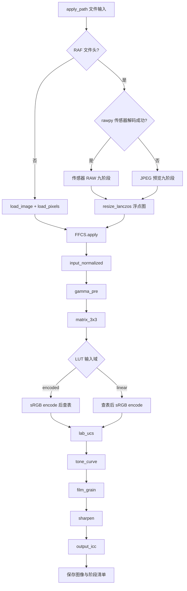

# 系统与完整 Pipeline

## 1. 数据与模块边界

像素统一为 `pixels[y][x]=(R,G,B)` 的 Python 嵌套序列。行从上到下、列从左到右，颜色通常在 [0,1]；输入编码域与线性域是两个不同的含义，不能因为范围相同而混用。一般算术使用 Python float；LUT 头矩阵是 float32 解包后转为 float，RAW 传感器读取与浮点缩放包含 float32 处理。每个颜色阶段保存独立的浮点像素映射和 8-bit Pillow 预览。

`models.py` 定义配置和名称；`color.py` 定义逐像素算子；`lutdata.py` 读取二进制表；`raw.py` 完成 RAF 前置处理；`effects.py` 做空间处理；`io.py` 负责输入输出；`pipeline.py` 决定分支和顺序；`metrics.py` 比较阶段；`cli.py` 为外部入口。`__init__.py` 导出公共 API，`__main__.py` 使 `python -m ffcs` 调用 CLI。

## 2. 所有入口和主流程

`apply` 和 `develop` 子命令最终都调用 `FFCS.apply_path`，命令名称本身不决定是否走 RAW 路径；文件头检测才决定。`apply_image` 是调用 apply_path 并保存的便利函数。`FFCS.apply` 可以直接接受 Pillow 图像、显式浮点 input_pixels、RAW 阶段和 RAW 元信息。

## 3. 颜色九阶段的实际数值域

| 阶段 | 处理 | 存储数值 |
|---|---|---|
| input_normalized | 显式 input_pixels 优先，否则由图像归一化 | 常规输入为编码 RGB；线性直入仍沿用此名称 |
| gamma_pre | 非线性输入逐通道 sRGB 解码；input_is_linear 时透传 | 线性 RGB |
| matrix_3x3 | 按 LUT 域选择矩阵路径，逐次夹取 | 线性 RGB |
| lut_3d | 表插值或解析变换，再施加 sigma | encoded 表为编码 RGB；linear 表为线性 RGB |
| lab_ucs | 必要时先编码，Lab 调饱和度/色相，再 OKLab 往返 | 编码 RGB，不保存 Lab 三元组 |
| tone_curve | 编码域对比度、暗部、高光曲线 | 编码 RGB |
| film_grain | 确定性亮度噪声/彩色噪声 | 编码 RGB |
| sharpen | 截断邻域均值反差增强 | 编码 RGB |
| output_icc | 保留 sRGB 或转换为 AdobeRGB 编码 | 输出空间编码 RGB |

输入标记 `input_is_linear=True` 不会改变 `input_normalized` 的元信息标签，消费者需要连同配置理解。相似地 `stage_contract` 的 Lab/UCS 描述表示计算过程，不表示保存的三个分量。

## 4. LUT 选择优先级与矩阵分支

1. `lut_path` 非空：读取外部 cube，覆盖 sim.lut、size、domain、source；不会载入相机内置表。未显式指定 domain 时使用 simulation 原有 domain。
2. 否则 `use_reference_luts=True`：若 camera/look 有内置数据，装入表和头部矩阵，强制 encoded，并记录资产相机。
3. 否则保持传入 FilmSimulation 的 LUT 或解析参数。**传入自定义 FilmSimulation 时，内置查找仍会按 camera/name 执行**；如需确保其自定义表保留，应设置 use_reference_luts=False。
4. sigma 配置最后覆盖模型的 sigma。

encoded 分支：`matrix_pixels=clip(M_sim * linear)`，相机矩阵不单独应用；之后编码并查表。linear 分支：`clip(M_sim * clip(M_camera * linear))`。两次 clip 不能合并至最后，否则负数或超范围数据的结果改变。

内置表包含整合的映射数据；代码仍应用容器头部矩阵。`matrix_fused_into_lut=True` 只表示选择了内置资产，不意味着数学上强制跳过头矩阵。实际交付表的头部矩阵逐一列于资产表，可据此复现。

## 5. 结果、导出和元信息

`PipelineResult.image` 是输出预览，`pixels` 是完整浮点结果；`stages` 是阶段预览字典，`stage_pixels` 为逐阶段浮点字典。阶段按插入顺序记录；RAW 阶段先合入，再运行九个颜色阶段。每次 `put` 复制行和三元组，避免后续修改污染既存阶段。

`save` 的 bits/space 默认取 metadata；改变 save 的 output_space 只改变标签参数，不会重新转换 pixels，所以应该在 PipelineConfig 里确定空间，再保存。

`save_stages` 写出同名 TIFF 和 pipeline.json。除 output_icc 外的 TIFF 都使用 sRGB 标签，**包括保存线性数值的阶段**；这些文件是数值诊断容器，应根据 pipeline.json 的 stage_domains 解释，普通图片查看器的显示亮度不是阶段色彩真值。16-bit TIFF 数值经过 round(v*65535) 的量化；浮点 stage_pixels 比它更精确。

stage_coverage/validate_contract 只检查阶段名称存在；RAW 九阶段与颜色九阶段齐全即 pass，并不证明算法校准或图像一致性。metadata 的 colour_management.embedded 固定写 True，实际 ICC 是否附带必须查看文件 tag 34675。approximation_metrics、reference_lut_validation 和 raw.decoder 用来判断运行分支及已有证据。

## 6. 性能和可用性

所有颜色循环和 RAW 邻域计算是 Python 循环。保存全部阶段同时保留多份整幅像素；RAW 加颜色为 18 阶段，大图片有显著内存与运行时间成本。LUT 使用 uint16 array 和路径级进程缓存，避免将 80³ 节点展开成大量对象。频谱诊断采用最大 32² 采样的直接 DFT；不是 FFT。

代码未实现分块、GPU、并行或缓存淘汰。输入应为非空矩形 RGB 序列；直接 API 对非法尺寸、NaN/Inf、未知输出空间的校验有限。CLI 对 bits/space/filter 有枚举约束；Python API 的调用者需遵守同样约定。
