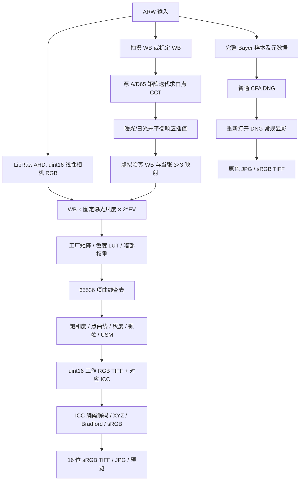

# 总体架构与数据契约

## 功能及模块

输入限定为 Sony ILCE-7RM5 Bayer RAW；标定参考为 Hasselblad X2D II 100C。主处理把 Sony 的线性相机颜色变成虚拟 X2D II 的线性颜色，再用保存的 Phocus 4.2.2 非 HDR 工厂颜色数据编码成工作 RGB。两种工作空间为 legacy Hasselblad RGB 和 Hasselblad L*RGB，拥有不同曲线编码和匹配 ICC。当前保存 profile 的工作空间为 legacy；不能因为 `hncs_codes` 函数的默认参数是 lstar 就假定 CLI 默认也是 lstar。

`hncs_pipeline.py` 负责 RAW 读取、色卡提取、原日光标定、颜色处理和 TIFF；`hncs_paired_illuminants.py` 实现默认两端直接响应；`hncs_dual_illuminant.py` 负责来源白点迭代以及独立公共矩阵的实验模式；`phocus_presets.py` 负责曲线选择和 RGB 预设效果；`process_photo_batch.py` 串联渲染与 `export_photo_original.py`，生成可交付照片。

## 数据形状与单位

| 阶段 | 类型/形状 | 单位与含义 |
|---|---|---|
| CFA | uint16，H×W | 解码的原传感器码值，尚未应用 HNCS |
| ROI 颜色 | float64，24×3 | 每通道扣黑后除共同 white−max(black)，通道中位数 |
| AHD 图 | uint16，H×W×3 | 单位 WB、线性相机 RGB、0…65535 |
| 归一化源 RGB | float64，…×3 | AHD/65535，乘 WB 与 source_scale；可超出 0…1 |
| 虚拟目标 RGB | float64，…×3 | 用当张 M 映射后的白平衡相机 RGB |
| 颜色核心输入码 | float64 表示的整数 | clip 到 0…1 后 rint×65535 |
| 内部 YCbCr | float64，…×3 | 16 位量级，后两通道除以 Y 得无量纲色度 |
| LUT 值 | float64，Cr×Cb×2 | 以 DivFactor 为尺度的映射后绝对色度坐标 |
| 工作 RGB | uint16，H×W×3 | 已写入颜色外观和曲线，不是线性传感器 RGB |
| sRGB | float64 0…1 / uint16 | 经过工作空间解码、色适应和显示编码 |

所有数学公式采用列向量 `y=Mx`。NumPy 像素按最后一维存 RGB，必须写 `samples @ M.T`。没有隐藏 RGB 通道交换，也没有仿射常量偏置。WB 三向量统一以 G=1 归一化。

## 依赖及资产契约

普通渲染需要根目录 5 份主要模块、批处理/导出模块，以及 `requirements.txt` 固定依赖。必须带上：

- `work/hncs-pipeline/assets/x2dii_phocus_422.npz`、两个 ICC、`provenance.json`；
- `work/hncs-pipeline/a7rv_to_x2dii.json`、`phocus_presets.json`；
- `work/hncs-finalization/paired_illuminants.json`、`sony_dcp_source_model.json`；
- 若使用 dual，附 `work/hncs-dual-illuminant/model.json`。

NPZ 包含所有工厂矩阵、色温节点、WB 表、LUT、Robertson 表、曲线和阈值。数据以 `allow_pickle=False` 读取。`load_assets` 检查 colour revision 及 NPZ/ICC SHA；`main` 检查 profile schema 和资产绑定；paired 检查源白点模型 SHA 和基准数值指纹。只替换矩阵文件却沿用旧 paired 文件会被拒绝，必须重拟合。

模型中的来源绝对路径是记录字段。默认运行定位以模块文件所在目录为 ROOT，paired 的 `source_model_path` 相对 ROOT 解析，所以整体目录可以移动。历史批处理记录中的绝对输出路径用于旧验证工具时需要重新生成；不要把它们当作可移植运行配置。

## 分块和方向

主颜色核按 `--chunk-rows` 分块，默认 96 行，并写 TIFF memmap。颜色核本身无空间邻域，块大小不应改变像素。AHD 解码仍一次得到全尺寸 RGB；非 Standard 预设会转换整个图像并分配中间数组，颗粒/USM 的内存消耗不受 96 行控制。

AHD 采用 `user_flip=0` 保持传感器方向。TIFF 通过 Orientation 保存显示方向；JPG 导出旋转实际像素。裁切按传感器方向在颜色渲染之前执行，读取 RelativeCrop 的 Left/Right/Top/Bottom，乘宽高并 round 到像素；预览颜色转换后才用于对比。
