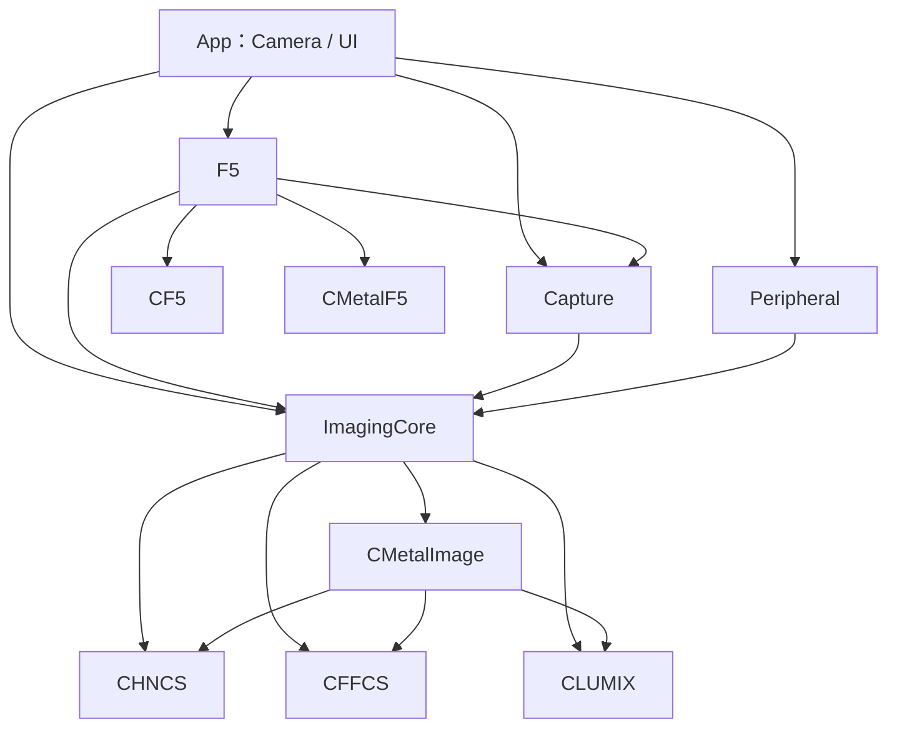

# 架构

GlassCam 以相机为首页，将取得源照片、生成成片和保存到系统相册组织为一个可恢复的单张拍摄事务。App 连接设备与界面，`GlassCamKit` 提供图像处理、拍摄事务、F5 和外围玻璃四个 Swift 模块，C++ 内核提供独立的数值处理。

术语见 [GLOSSARY.md](../GLOSSARY.md)；构建与运行入口见 [README.md](../README.md)，测试方法见 [testing.md](testing.md)。

## 模块职责与依赖

模块依赖由 [Package.swift](../Packages/GlassCamKit/Package.swift) 声明，箭头表示调用方依赖被调用方。

| 层或模块 | 职责 | 主要边界 |
|---|---|---|
| `App/GlassCam/UI` | SwiftUI 相机首页、设置、回看、系统相册和文件交付 | `ContentView` 持有设置与拍摄事务；`HEIFSaveDelivery` 连接 Photos |
| `App/GlassCam/Camera` | AVFoundation 会话、主摄 Bayer RAW 捕获、双路取景帧与方向 | `CameraController` 发布界面状态；`CameraBackend` 在专用队列操作设备 |
| `ImagingCore` | 处理配方、源照片与工作文件、RAW 解码、色彩引擎、浮点图像、HEIF 和分享表示 | 为其他 Swift 模块提供共用图像模型，调用 `CHNCS`、`CFFCS`、`CLUMIX` |
| `Capture` | 相机设置、输出选择、拍摄状态机、持久化记录与恢复 | 通过 `Services` 注入授权、处理和保存，通过 `CaptureFormat` 扩展源照片格式 |
| `F5` | 单帧／四帧 Bayer RAW 的解码、曲率重建、颜色桥、来源记录、暂存和归档 | 实现 `F5CaptureFormat`，使用 `CMetalF5` 与 Metal，保留 `CF5` 数值参考，输出交给 `ImagingCore` 编码 |
| `Peripheral` | 照片区几何、中心与外围帧配对、可见接缝测量、遮罩和 Metal 呈现 | 接收 App 提供的帧及元数据，输出取景显示状态 |
| `CHNCS`、`CFFCS`、`CLUMIX`、`CF5` | C++17 数值处理和 C ABI | 编译使用 `-fno-fast-math -ffp-contract=off` |
| `CMetalImage` | 成片颜色、原生整数锐化、GPU 调度与分块落盘 | 复用 C++ 参考上下文的数据；颜色按 HDR 预算验收，整数锐化逐值一致 |

`ImagingCore` 是 Swift 依赖图的底层；`Capture` 与 `Peripheral` 互不依赖。`F5` 依赖 `Capture` 定义的格式接口，`Capture` 通过注册表调用格式实现。App 的组合入口创建 `CaptureFormats([F5CaptureFormat()])`，并把同一注册表传给处理服务与拍摄记录。

色彩资源通过 `ColorResources` 从 App 资源目录注入。资源位置属于运行依赖，处理配方保存色彩选择与版本；HNCS、FFCS、LUMIX 的细节分别见 [HNCS](color/hncs.md)、[FFCS](color/ffcs.md) 和 [LUMIX](color/lumix.md)。

成片的 GPU 路径、缓冲上限和精度预算见 [图像管线与成片导出](image-pipeline.md)。CPU 数值 API 与固定 golden 保留，Metal 颜色实现单独与它们比较。

性能测量、设备诊断与实验入口由 `GlassCam-research` 的 `tools/studies/product-tooling/` 和 `tools/studies/product-experiments/` 使用固定源码快照构建。

## 从快门到保存

1. **冻结拍摄选择。** `CameraView` 向 `CameraController` 预留当前构图和方向，创建包含处理配方、输出选择、质量与 F5 归档选择的 `CaptureSnapshot`，再交给 `CaptureWorkflow` 请求相册添加权限。
2. **取得源照片。** 授权完成后，工作流调用预留的相机请求。Speed／Balanced 由 `F5CaptureDriver` 在物理主摄原生视角分别取得一帧／四帧 Bayer RAW。终结回调确认源数据和实际构图信息，相机后端另行恢复双摄取景。
3. **保留可恢复输入。** 工作流把实际构图合入冻结快照，通过 `F5CaptureFormat` 将格式载荷交给 `CaptureJournal` 保留为 `rawReady` 记录（`schemaVersion: 2`，`burst/` 目录；内部服务测试仍保留单张 `schemaVersion: 1` 的 `source.dng` 入口）。后台保留操作同时返回记录与已校验载荷，工作流直接继续使用。
4. **按需保留调色前结果并生成成片。** F5 先重建场景线性图像，再进入共用的色彩与 HEIF 路径。当快照携带 `rawArchiveID`（开启调色前原片归档开关）时，Balanced 的合成 DNG／线性 TIFF 先由 `CaptureRAWStore` 独立保存，再应用品牌色彩；默认关闭时不写出调色前原片。最终输出统一为约 24MP 的 10 位 HDR HEIF，详见 [图像管线与成片导出](image-pipeline.md) 和 [F5](f5.md)。
5. **保留编码结果。** 工作流从成片生成回看图像，并将 HEIF、尺寸与处理后的快照写入记录，进入 `encodedReady`。后续保存重试复用这份编码文件。
6. **写入系统相册。** 工作流先持久化带尝试标识的 `savePending`，再由 `HEIFSaveDelivery` 复制原始 HEIF 到 Photos。系统确认成功后记录为 `savedConfirmed`，随后清理活动记录并发布 `SavedCapture`。
7. **回看与分享。** 相机首页保留拍摄入口，用户从缩略图打开已保存成片。回看、文件导出和原始 HEIC 分享持有同一成片文件；接收方请求 JPEG 时，由分享提供者从该 HEIF 按需生成兼容表示。

工作流由根视图持有，打开设置页或回看页时保持同一实例。界面状态在主线程发布；设备会话在相机串行队列操作；解码、处理和记录文件操作离开主线程执行。进入后台或受保护数据不可用时暂停后续处理，恢复可用后继续同一事务；重启后的记录恢复规则见 [拍摄与恢复](capture-and-recovery.md)。

## 取景数据流

App 的相机后端向中心显示层和 `Peripheral` 投递视频帧。中心画面、可选实时色彩代理、外围接缝判断与玻璃遮罩组成取景显示链；快门取得的源照片独立进入成片处理链。

照片区按输出比例在窗口中居中，控制区利用外围空间，空间不足时使用独立面板。取景布局与实时色彩见 [取景](viewfinder.md)，帧配对、接缝与遮罩见 [外围玻璃](peripheral-glass.md)。

## 不变量

1. 快门冻结的处理配方、输出和质量在后续设置变化及重试中保持不变。— `CaptureTests/WorkflowTests.settingsMutation_doesNotRetargetFrozenCaptureOrRetry`
2. 拍摄等待期间重复快门或重复回调只接纳同一张照片。— `CaptureTests/WorkflowTests.pendingCapture_rejectsSecondShutterAndDuplicateCallback`
3. 保存失败后的重复重试复用已编码 HEIF，且只发起一次新的保存。— `CaptureTests/WorkflowTests.saveFailure_duplicateRetryReusesEncodedFile`
4. 已终结成功的源照片在视图停止或取景恢复失败后仍交付。— `GlassCamTests/CameraLifecycleTests.committedPhoto_survivesStoppedViewOrPreviewFailure`
5. 重启遇到保存结果未知的记录时，必须经明确选择才继续保存或确认完成。— `CaptureTests/RecoveryTests.unknownSave_requiresExplicitResolution`
6. 已有持久化成功回执的照片在重启后只清理记录，不重复写入相册。— `CaptureTests/RecoveryTests.durableReceipt_restartDoesNotSaveAgain`
7. 相册保存复制原始 HEIF 字节，并保留源文件所有权。— `GlassCamTests/PhotoDeliveryTests.photoImport_keepsOriginalHEIFBytesNameAndOwnership`
8. 原始 HEIC 分享表示保留最终成片的字节。— `ImagingCoreTests/ShareTests.heicRepresentation_preservesOriginalBytes`
9. 单张、F5 和规范化 Speed 拍摄记录样本经解码再编码保持字节一致。— `F5Tests/currentJournal_decodeEncodePreservesBytes`

## 数据与版本

`ProcessingRecipe` 保存像素处理所需的选择与版本；`CaptureSnapshot` 增加输出、质量和格式来源信息。相机偏好由 `CameraSettingsStore` 恢复与迁移，已拍摄照片按其记录中的配方解码，二者有各自的生命周期。

`CaptureJournal` 对相机拍摄的 F5 格式使用 schema 2（`burst/` 载荷，成片文件名为 `result.heic`），内部单张输入入口保留 schema 1（`source.dng`）。活动目录内的 `capture.json` 保存事务阶段、冻结快照和文件字节数及 SHA-256。格式实现负责自身载荷，Journal 统一活动目录的文件保护与备份排除，工作流负责记录阶段和相册事务的顺序。成功收尾与明确放弃分别执行；放弃不要求损坏记录通过解码，也不执行归档。

持久化键、配方解码与异常恢复的具体约定见 [拍摄与恢复](capture-and-recovery.md)，架构取舍见 [架构决策](adr/README.md)，固定兼容样本见 [journal fixtures](../tests/fixtures/journal/README.md)。

## 已知限制

- Swift 图像与显示模块依赖 Apple 框架，跨平台构建范围为 C++ 数值内核。
- 处理取消在检查点生效，正在执行的同步 Apple 解码或编码调用需先返回。
- Photos 事务提交后无法撤销，进程中断可能留下需要用户核对的保存结果。
- 普通源照片的持久化用于完成单张拍摄事务，保存确认后的清理会移除其恢复文件。

## 代码入口

- [GlassCamApp.swift](../App/GlassCam/UI/GlassCamApp.swift)、[ContentView.swift](../App/GlassCam/UI/ContentView.swift)：资源、格式注册表、设置和根工作流的组合入口。
- [CameraView.swift](../App/GlassCam/UI/CameraView.swift)、[CameraController.swift](../App/GlassCam/Camera/CameraController.swift)：快门快照、拍摄预留与设备状态。
- [CameraBackend.swift](../App/GlassCam/Camera/CameraBackend.swift)、[F5CaptureDriver.swift](../App/GlassCam/Camera/F5CaptureDriver.swift)：会话生命周期与源照片终结回调。
- [CaptureWorkflow.swift](../Packages/GlassCamKit/Sources/Capture/CaptureWorkflow.swift)、[CaptureJournal.swift](../Packages/GlassCamKit/Sources/Capture/CaptureJournal.swift)：单张事务、文件记录与恢复。
- [CaptureFormats.swift](../Packages/GlassCamKit/Sources/Capture/CaptureFormats.swift)、[F5CaptureFormat.swift](../Packages/GlassCamKit/Sources/F5/F5CaptureFormat.swift)：源格式协议与 F5 接入。
- [ImagePipeline+Export.swift](../Packages/GlassCamKit/Sources/ImagingCore/Processing/ImagePipeline+Export.swift)、[F5ImagePipeline.swift](../Packages/GlassCamKit/Sources/F5/F5ImagePipeline.swift)：完整源处理、F5 重建与成片生成。
- [HEIFSaveDelivery.swift](../App/GlassCam/UI/HEIFSaveDelivery.swift)、[ShareDelivery.swift](../Packages/GlassCamKit/Sources/ImagingCore/Processing/ShareDelivery.swift)：系统相册、文件导出与分享表示。
- [PeripheralFrameSource.swift](../Packages/GlassCamKit/Sources/Peripheral/PeripheralFrameSource.swift)、[PeripheralLiveDisplay.swift](../Packages/GlassCamKit/Sources/Peripheral/PeripheralLiveDisplay.swift)：取景帧处理与同步呈现。
