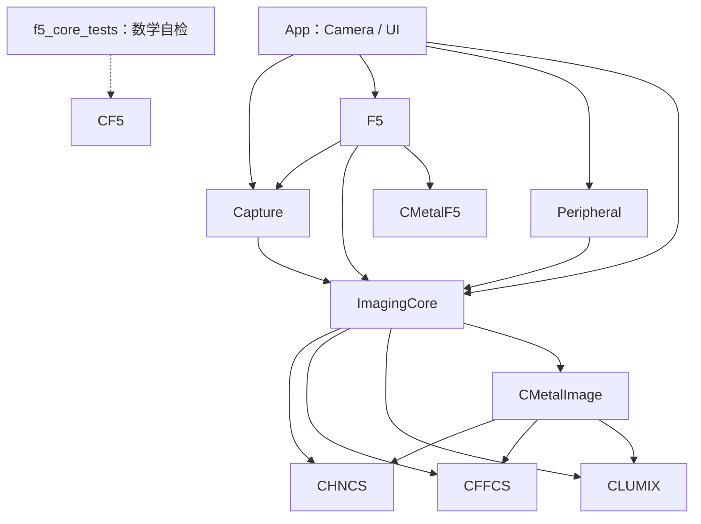

# 架构

GlassCam 以相机为首页，用两个持久槽位管理从取得源照片到保存成片的事务；每个槽位独立恢复，大图重建与编码串行执行。App 连接设备与界面，`GlassCamKit` 提供图像处理、拍摄事务、F5 和外围玻璃四个 Swift 模块，C++ 与 Metal 承担数值计算。

术语见 [GLOSSARY.md](../GLOSSARY.md)；构建与运行入口见 [README.md](../README.md)，测试方法见 [testing.md](testing.md)。

## 工作方式

### 模块职责与依赖

模块依赖由 [Package.swift](../Packages/GlassCamKit/Package.swift) 声明，箭头表示调用方依赖被调用方。

| 层或模块 | 职责 | 主要边界 |
|---|---|---|
| `App/GlassCam/UI` | SwiftUI 相机首页、设置、回看、系统相册和文件交付 | `ContentView` 持有设置与 `CaptureQueue`；`HEIFSaveDelivery` 连接 Photos |
| `App/GlassCam/Camera` | AVFoundation 会话、主摄 Bayer RAW 捕获、双路取景、测光与物理方向 | `CameraController` 发布界面状态；`CameraBackend` 在专用队列操作设备 |
| `ImagingCore` | 处理配方、源照片与工作文件、RAW 解码、色彩引擎、浮点图像、HEIF 和分享表示 | 为其他 Swift 模块提供共用图像模型，调用 `CHNCS`、`CFFCS`、`CLUMIX` |
| `Capture` | 两槽队列、单槽事务、相机设置、持久恢复与最近成片缓存 | 通过 `Services` 注入授权、处理和保存，通过 `CaptureFormat` 扩展源照片格式 |
| `F5` | 单帧／四帧 Bayer RAW 的解码、曲率重建、颜色桥、来源记录、暂存和归档 | 实现 `F5CaptureFormat`，调用 `CMetalF5` 与 Metal，输出交给 `ImagingCore` 编码 |
| `Peripheral` | 照片区几何、中心与外围帧配对、可见接缝测量、遮罩和 Metal 呈现 | 接收 App 提供的帧及元数据，输出取景显示状态 |
| `CHNCS`、`CFFCS`、`CLUMIX` | C++17 参考色彩核和 C ABI | 编译使用 `-fno-fast-math -ffp-contract=off` |
| `CF5` | 早期样条模型的 CPU 数学参考 | 无生产 Swift 调用，无图像 golden；由 `f5_core_tests` 自检 |
| `CMetalF5` | RAW 归一化、配准、曲率、镜头输出与归档的 GPU 调度 | 管理受预算约束的 GPU 资源及工作文件 |
| `CMetalImage` | 浮点搬运、成片颜色、整数锐化、GPU 调度与分块落盘 | C++／NEON 搬运保持位型；颜色按 HDR 预算验收，整数锐化逐值一致 |

`ImagingCore` 是 Swift 依赖图的底层；`Capture` 与 `Peripheral` 互不依赖。`F5` 依赖 `Capture` 定义的格式接口，`Capture` 通过注册表调用格式实现。App 的组合入口创建 `CaptureFormats([F5CaptureFormat()])`，并把同一注册表传给处理服务与拍摄记录。

### 构建产物与消费者

| 产物 | 类型与内容 | 仓库内消费者 |
|---|---|---|
| `GlassCam.app` | Xcode 应用，包含 SwiftUI／AVFoundation、色彩资源与 `default.metallib` | iOS 运行与 App／UI 模拟器测试 |
| `GlassCamKit` | SwiftPM 自动链接类型库，聚合 `ImagingCore`、`Capture`、`F5`、`Peripheral` | App 工程唯一链接的 package product |
| `GlassCamNative` | 动态库，聚合 `CHNCS`、`CFFCS`、`CLUMIX`、`CF5` | `scripts/native_build.py` 构建，`tests/numeric` 经 `ctypes` 加载 |
| `GlassCamNativeTestSupport` | 动态库，暴露 `NativeTestSupport` 的私有测试桥与 HDR 指标 | Python 数值测试；`ImagingCoreTests` 直接依赖同名底层 target `NativeTestSupport` |
| `GlassCamCore` | 未指定 `.static`／`.dynamic` 的纯 C++ 聚合库 product | 仓库无直接消费该 product 的 target；各 C++ target 可独立构建和验证 |

Xcode 将 `F5Kernels.metal`、`NativeSharpness.metal`、`ColorKernels.metal` 和 `PeripheralGlassShaders.metal` 编入 App 的 `default.metallib`。F5 显式关闭 fast-math；锐化和颜色另关闭隐式浮点融合；外围采用默认编译选项。SwiftPM 拷贝同名资源，F5 与成片测试运行时以 safe／precise 编译源码；外围 GPU 测试及 App 回退路径使用 `PeripheralGlassShader.source` 内嵌源码与默认选项。

色彩资源由 `ColorResources` 从 App 资源目录注入，处理配方只保存色彩选择与版本。逐文件修改边界见 [ADR 0017](adr/0017-native-and-metal-contracts.md)，缓冲上限和 GPU 色差预算见[图像管线](image-pipeline.md)。

### 端到端像素与色彩空间流转

| 阶段 | 数据载体 / 格式 | 色彩空间与传递函数 | 白平衡 / 基准曝光 / 用户曝光归属 | 内存驻留形态 |
|---|---|---|---|---|
| 主摄源照片 | 14-bit Bayer 码值，UInt16 缓冲及 DNG，Speed 一帧／Balanced 四帧 | 相机 CFA，原始传感器码值 | 硬件固定曝光、ISO、焦点和白平衡；保留 DNG 元数据 | DNG 与整数工作文件；逐帧映射并上传 |
| `F5CurvatureRAW` | Float32 归一化样本平面及 UInt8 类别平面 | 相机线性域，统一黑白尺度与相对曝光 | 扣黑、线性化、RAW 校正与帧间曝光归一化；不施加传感器白平衡或用户 EV | 各帧归一化平面驻留 GPU；整数上传缓冲逐帧释放 |
| 配准与曲率重建 | 位移、光度可靠度；重叠输出条带的 Float32 RGBA | linear-camera；单帧原生密度／四帧双密度 | 单帧自身或四帧第 2 帧为参考；保留有符号值与 HDR | GPU 整组 RAW 加有界 FFT／导引工作区；条带写工作文件 |
| 镜头校正与 `F5ColorBridge` | `ExportRasterFile`；按需另存 `linear-camera.f32` | 相机 RGB → XYZ D50 → D65 扩展线性 sRGB，无显示曲线 | 镜头操作按序；矩阵含一次传感器白平衡与一次 `BaselineExposure` | 镜头与矩阵逐条处理；源／结果文件以 `pread` 分块供给 CI |
| 公共效果曝光 | Float32 RGB／RGBA 条带或 CI Metal 纹理 | 扩展线性 sRGB | 用户效果曝光在此施加 `2^EV`；当前引擎收到零后端曝光 | C++／NEON 或 Metal 分条执行 |
| HNCS revision 12 | 有界颜色输入 → Float32 编码工作 RGB → 扩展线性 sRGB | Hasselblad RGB 或 L*RGB 工作原色及曲线 | xy 建虚拟拍摄基线；颜色核后、空间处理前恢复 HDR 幅度；全图共享 `workScale` | 完整 RGB 工作文件；CPU 颜色、GPU 整数锐化和 CPU 结束阶段分条读写 |
| FFCS / LUMIX | `max(1,R,G,B)` 幅度与归一化颜色，Float32 结果 | FFCS 原始网格整数映射／LUMIX RGB48→RGB12 整数链；返回 display-linear sRGB | 源已白平衡；LUMIX CCT 与 ISO 选表；效果处理后恢复 HDR 幅度 | CPU 参考条带或 Metal 纹理；不可变 LUT 复用 |
| Lanczos 24MP | 完成色彩与空间处理的 Float32 RGBA | 线性光重采样；HNCS 末端转线性 BT.2020 后裁剪 | 不重复曝光与白平衡 | 工作文件按 256×256 块读取，CI 执行缩放 |
| 保存与回看 | HEIF10 文件、Float32 回看图 | BT.2020 / PQ；回看解码为扩展线性 sRGB | 保留照片元数据，方向规范为 1 | 编码器读取工作文件；384px 常驻、4096px 按需回看 |
| JPEG 分享副本 | 按需生成的同尺寸 8-bit JPEG | sRGB / SDR，先压缩 HDR headroom | 只转换已完成 HEIF | 文件所有者持有 HEIF；请求 JPEG 时编码并缓存 |

性能测量、设备诊断与实验入口由 `GlassCam-research` 的 `tools/studies/product-tooling/` 和 `tools/studies/product-experiments/` 使用固定源码快照构建。

### 从快门到保存

1. **冻结拍摄选择。** `CameraView` 向 `CameraController` 预留当前构图和物理拍摄方向，创建 `CaptureSnapshot`；`CaptureQueue` 分配槽位，其 `CaptureWorkflow` 请求相册添加权限。
2. **取得源照片。** 授权完成后，工作流调用预留的相机请求。Speed／Balanced 由 `F5CaptureDriver` 在物理主摄原生视角分别取得一帧／四帧 Bayer RAW。终结回调确认源数据和实际构图信息，相机后端另行恢复双摄取景。
3. **保留可恢复输入。** 工作流把实际构图合入冻结快照，通过该槽位的 `F5CaptureFormat` 和 `CaptureJournal` 保留 `rawReady` 记录。后台操作返回已校验载荷后，空余槽位可接纳另一张照片；相机另需恢复取景。大图处理共享串行许可。
4. **按需保留调色前结果并生成成片。** F5 先重建场景线性图像，再进入共用的色彩与 HEIF 路径。当快照携带 `rawArchiveID`（开启调色前原片归档开关）时，Balanced 的合成 DNG／线性 TIFF 先由 `CaptureRAWStore` 独立保存，再应用品牌色彩；默认关闭时不写出调色前原片。最终输出统一为约 24MP 的 10 位 HDR HEIF，详见 [图像管线与成片导出](image-pipeline.md) 和 [F5](f5.md)。
5. **保留编码结果。** 工作流从成片生成回看图像，并将 HEIF、尺寸与处理后的快照写入记录，进入 `encodedReady`。后续保存重试复用这份编码文件。
6. **写入系统相册。** 工作流先持久化带尝试标识的 `savePending`，再由 `HEIFSaveDelivery` 复制原始 HEIF 到 Photos。系统确认后写 `savedConfirmed` 与首次 `confirmedAt`，保存最近回看副本，再清理该槽位。
7. **回看与分享。** `LatestReviewStore` 原子发布最近确认成片，重启异步恢复缩略图。回看与分享文件独立于可被清理的槽位和缓存代次；接收方请求 JPEG 时，从 HEIF 按需生成兼容表示。

工作流由根视图持有，打开设置页或回看页时保持同一实例。界面状态在主线程发布；设备会话在相机串行队列操作；解码、处理和记录文件操作离开主线程执行。进入后台或受保护数据不可用时暂停后续处理，恢复可用后继续同一事务；重启后的记录恢复规则见 [拍摄与恢复](capture-and-recovery.md)。

### 取景数据流

App 的相机后端向中心显示层和 `Peripheral` 投递视频帧。中心画面、可选实时色彩代理、外围接缝判断与玻璃遮罩组成取景显示链；快门取得的源照片独立进入成片处理链。

照片区按输出比例在窗口中居中，控制区利用外围空间，空间不足时使用独立面板。取景布局与实时色彩见 [取景](viewfinder.md)，帧配对、接缝与遮罩见 [外围玻璃](peripheral-glass.md)。

## 不变量

1. 快门冻结的处理配方、输出和质量在后续设置变化及重试中保持不变。— `CaptureTests/WorkflowTests.settingsMutation_doesNotRetargetFrozenCaptureOrRetry`
2. 单槽拍摄等待期间拒绝重复快门与重复回调；队列最多容纳两张照片且大图处理串行。— `CaptureTests/WorkflowTests.pendingCapture_rejectsSecondShutterAndDuplicateCallback`、`CaptureTests/CaptureQueueTests.retainedFirstPhoto_admitsSecondAndBoundsProcessingAndCapacity`
3. 保存失败后的重复重试复用已编码 HEIF，且只发起一次新的保存。— `CaptureTests/WorkflowTests.saveFailure_duplicateRetryReusesEncodedFile`
4. 已终结成功的源照片在视图停止或取景恢复失败后仍交付。— `GlassCamTests/CameraLifecycleTests.committedPhoto_survivesStoppedViewOrPreviewFailure`
5. 重启遇到保存结果未知的记录时，必须经明确选择才继续保存或确认完成。— `CaptureTests/RecoveryTests.unknownSave_requiresExplicitResolution`
6. 已有持久化成功回执的照片在重启后只清理记录，不重复写入相册。— `CaptureTests/RecoveryTests.durableReceipt_restartDoesNotSaveAgain`
7. 相册保存复制原始 HEIF 字节，并保留源文件所有权。— `GlassCamTests/PhotoDeliveryTests.photoImport_keepsOriginalHEIFBytesNameAndOwnership`
8. 原始 HEIC 分享表示保留最终成片的字节。— `ImagingCoreTests/ShareTests.heicRepresentation_preservesOriginalBytes`
9. 单张、F5 和规范化 Speed 拍摄记录样本经解码再编码保持字节一致。— `F5Tests/currentJournal_decodeEncodePreservesBytes`
10. 两个槽位重启后沿用各自冻结快照，仍串行处理；放弃一槽不终止另一槽。— `CaptureTests/CaptureQueueTests.restartingQueue_recoversBothFrozenSlotsSerially`、`discardingFailedPhoto_keepsOtherSlotProcessing`
11. 恢复旧回执不会覆盖更近的回看成片，缓存替换保留正在分享的文件所有者。— `CaptureTests/LatestReviewTests.recoveringOlderReceipt_doesNotReplaceMoreRecentlyConfirmedPhoto`、`replacement_keepsOneGenerationAndExistingShareOwner`

## 数据与版本

`ProcessingRecipe` 保存像素处理所需的选择与版本；`CaptureSnapshot` 增加输出、质量和格式来源信息。相机偏好由 `CameraSettingsStore` 恢复与迁移，已拍摄照片按其记录中的配方解码，二者有各自的生命周期。

`CaptureQueue` 使用 `GlassCam/PendingCaptures/slot-0` 与 `slot-1`，F5 暂存也按槽位隔离。每槽的 `CaptureJournal` 对相机 F5 输入使用 schema 2（`burst/` 与 `result.heic`），内部单文件入口保留 schema 1（`source.dng`）。`capture.json` 保存阶段、冻结快照、首次确认时间与文件校验值；格式实现负责载荷，Journal 负责文件保护及备份排除。

最近回看使用 `GlassCam/LatestReview/latest.json`（schema 1）指向一个不可变代次，按 `confirmedAt` 排序。具体所有权、重试和清理见[拍摄与恢复](capture-and-recovery.md)。

持久化键、配方解码与异常恢复的具体约定见 [拍摄与恢复](capture-and-recovery.md)，架构取舍见 [架构决策](adr/README.md)，固定兼容样本见 [journal fixtures](../tests/fixtures/journal/README.md)。

## 已知限制

- Swift 图像与显示模块依赖 Apple 框架，跨平台构建范围为 C++ 数值内核。
- 处理取消在检查点生效，正在执行的同步 Apple 解码或编码调用需先返回。
- Photos 事务提交后无法撤销，进程中断可能留下需要用户核对的保存结果。
- 普通源照片的持久化用于完成单张拍摄事务，保存确认后的清理会移除其恢复文件。

## 代码入口

- [GlassCamApp.swift](../App/GlassCam/UI/GlassCamApp.swift)、[ContentView.swift](../App/GlassCam/UI/ContentView.swift)：资源、格式注册表、设置和根工作流的组合入口。
- [CameraView.swift](../App/GlassCam/UI/CameraView.swift)、[CameraController.swift](../App/GlassCam/Camera/CameraController.swift)：快门快照、拍摄预留与设备状态。
- [CameraBackend.swift](../App/GlassCam/Camera/CameraBackend.swift)、[F5CaptureDriver.swift](../App/GlassCam/Camera/F5CaptureDriver.swift)：会话生命周期与源照片终结回调。
- [CaptureWorkflow.swift](../Packages/GlassCamKit/Sources/Capture/CaptureWorkflow.swift)、[CaptureJournal.swift](../Packages/GlassCamKit/Sources/Capture/CaptureJournal.swift)：单张事务、文件记录与恢复。
- [CaptureQueue.swift](../Packages/GlassCamKit/Sources/Capture/CaptureQueue.swift)、[LatestReviewStore.swift](../Packages/GlassCamKit/Sources/Capture/LatestReviewStore.swift)：两槽准入、串行处理与跨启动回看。
- [CaptureFormats.swift](../Packages/GlassCamKit/Sources/Capture/CaptureFormats.swift)、[F5CaptureFormat.swift](../Packages/GlassCamKit/Sources/F5/F5CaptureFormat.swift)：源格式协议与 F5 接入。
- [ImagePipeline+Export.swift](../Packages/GlassCamKit/Sources/ImagingCore/Processing/ImagePipeline+Export.swift)、[F5ImagePipeline.swift](../Packages/GlassCamKit/Sources/F5/F5ImagePipeline.swift)：完整源处理、F5 重建与成片生成。
- [HEIFSaveDelivery.swift](../App/GlassCam/UI/HEIFSaveDelivery.swift)、[ShareDelivery.swift](../Packages/GlassCamKit/Sources/ImagingCore/Processing/ShareDelivery.swift)：系统相册、文件导出与分享表示。
- [PeripheralFrameSource.swift](../Packages/GlassCamKit/Sources/Peripheral/PeripheralFrameSource.swift)、[PeripheralLiveDisplay.swift](../Packages/GlassCamKit/Sources/Peripheral/PeripheralLiveDisplay.swift)：取景帧处理与同步呈现。
