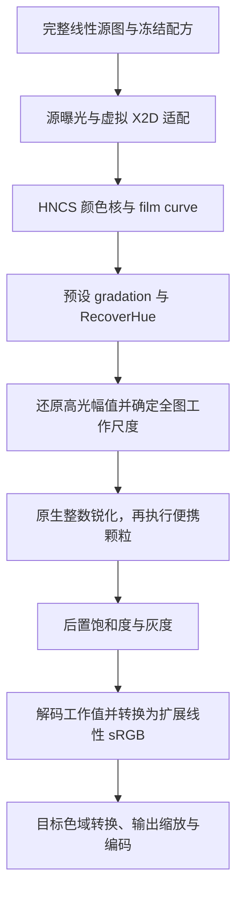

# HNCS

HNCS 将已解码的源照片转换为所选 Hasselblad 工作空间中的颜色、明暗和细节效果，再交回图像管线生成成片。`CHNCS` 实现数值处理，`HNCSEngine` 管理配方、原生上下文和工作文件；Bayer 重建由 F5 负责，导入 RAW 解码与最终编码由 `ImagePipeline` 负责。

## 工作方式

### 输入前提

输入为已经完成源白平衡和基准曝光的扩展线性 sRGB，允许有限负值与大于 1 的高光。公共管线先施加用户效果曝光。revision 12 分离 HDR 幅度后进入有界虚拟传感器与 UInt16 颜色核，再在 HNCS 工作域恢复幅度后执行空间效果；输出原色转换保留有符号的扩展线性 sRGB。

### 白平衡与 ISO

源白平衡在 HNCS 之前完成：Speed／Balanced 由 F5 相机矩阵处理，导入 RAW 由 Apple 解码器处理。`PhotoWhiteBalance` 保存本张照片的完整 xy 白点及其温度、Tint 信息；HNCS 用 xy 构造虚拟 X2D 拍摄增益基线，色温只用于工厂矩阵与 LUT 的选择。处理配方绑定白点后，重试和导出沿用该值。

`whiteBalancePolicy` 决定预设是否替换照片的白平衡：

| 策略 | 目标增益 | 默认工厂色温 |
|---|---|---|
| `photo`（Photo · Automatic） | 等于照片的虚拟拍摄增益，保留现场白平衡 | 从照片 xy 得到的 CCT |
| `preset`（Original preset） | 使用预设的固定目标增益；预设没有固定值时保留拍摄增益 | 预设色温；没有固定值时使用照片 CCT |

`factoryKelvinOverride` 只覆盖工厂矩阵与 LUT 的插值色温，范围为 2000–10000 K。捕获白点、目标增益和工厂色温分别保存；适配器使用目标相对于拍摄基线的调整，避免对已白平衡的 RGB 再施加整份目标增益。没有照片白点的旧参考调用使用保留的 CCT 入口。

源 ISO 保留在拍摄元数据中，不参与 HNCS 颜色选表；RAW 噪声与传感器处理属于上游 F5 或系统解码器。

Nature 的原始白平衡为 5500 K 和 Phocus Tint `−0.003333333333333333`，主曲线控制点为 `(0,0)、(71,31)、(184,223)、(255,255)`。选择 `photo` 保留这条明暗曲线及其他参数，只让白平衡跟随照片；这也适用于 Daylight、Cloudy 等带固定白平衡的预设。Apple Tint 与 Phocus Tint 使用不同单位，完整 xy 保留绿／洋红方向的信息。

### 颜色与空间阶段

新建配方使用 `pipelineRevision = 2`、HNCS `renderRevision = 12`。完整源导出在裁剪后、下采样前完成整条处理：



颜色核将虚拟原生 RGB 量化为 UInt16，经输入矩阵得到亮度和归一化色度，再对二维绝对色度 LUT 作双线性插值。灰度与暗部权重调节色度，以 Y 为重建基线形成工作 RGB，最后查所选 film curve。`standard` 与 `reproduction` 使用各自的工厂配置；`legacy` 与 `lstar` 分别选择 Hasselblad RGB 与 Hasselblad L*RGB 的工作原色和传递函数。

`asShot` 是曲线选择哨兵。Apple 输入没有 Phocus FilmCurve 元数据，因此明确以 `rawFilmCurveType = 2` 解析为 Standard；其他选择为 Old Standard（0）、High Contrast（1）、Standard（2）、Low Contrast（6）和 Linear（7）。`reproduction` 始终解析为 type 7；Old Standard 只在 legacy 工作空间中有独立曲线。预设 gradation 在没有用户曲线调整时仍执行原表和 RecoverHue；关闭 `applyToneCurve` 只跳过 Points 对应的曲线，Gamma 和 contrast 阶段继续执行。

原生锐化使用预设参数、完整分辨率像素尺度、复制边缘和 RAW 的 `BaselineSharpness`，缺失该元数据时取 0。HNCS 输入关闭 Apple 解码器锐化，防止重复施加细节处理。只含单个工具的预设叠加原厂 Standard 参数，因此 Standard 和工具预设也可能启用原生锐化。

成片的源矩阵、原始颜色 LUT、gradation 和高光工作域转换保留精确 C++，原生整数锐化由 Metal 执行并与 CPU 逐值一致。原生渲染器复用缓冲并直接读写工作文件，颗粒和后置颜色结束阶段也使用 C++；数据流与误差预算见 [图像管线与成片导出](../image-pipeline.md)。

颗粒采用保留的便携模型：预设键与裁剪后整图尺寸决定 SHA-256／PCG64 随机流，随后执行 wrap Gaussian 和全图 Float32 统计。工作文件按自上而下的 RGB Float32 行序读写；分条只改变 I/O 大小，空间处理始终看到同一张完整工作图。取消或错误时丢弃部分结果，工作文件所有者释放暂存文件。

### HDR 工作域

revision 12 接收完整扩展线性源值。每像素以 `g = max(1, R, G, B)` 得到有界颜色输入；颜色核和 gradation 后，在工作空间恢复幅值：

```text
w = encode_working(decode_working(code / 65535) × g)
```

`g = 1` 时直接保留原 Float32 工作值，避免多余的传递函数往返。legacy 工作空间使用原 ICC gamma，L*RGB 使用 L* 定义；`w` 是可超过 1 的编码工作值。

扫描整张裁剪后工作图的最大分量 `maximum`，选取唯一尺度：

```text
S = 1                              maximum ≤ 1
S = max(5.8829245141, maximum)      maximum > 1
```

有限工作值和尺度的上限均为 64。空间入口按 `S` 将整图打包到 `[0,1]`；原生锐化的 amount／noise 表采用相同尺度，使参考白以上的明暗差进入亮度、模糊和阈值计算。颗粒幅度按参考白定义，打包时除以 `S`。即使关闭颗粒与锐化，也要完成这次全图打包。

结束阶段使用绑定了同一 `S` 的不可变上下文，将后置颜色结果解码回工作线性值，再转换为带符号的 extended-linear-sRGB。负分量和超过 1 的分量保留到目标色域转换；末端在线性 BT.2020 中执行范围处理和 PQ 编码。revision 12 不另存逐像素 gain 图，也不在锐化后再次乘回旧 gain；旧记录中的 revision 11 按保存版本走原有的高光分离／恢复路径。

### 效果开关与缓存

`EffectToggles` 中颗粒、锐化、额外裁剪独立保存，默认均为 `true`。打开开关只启用预设已有的阶段，不修改预设参数；颗粒以 catalog 标志判断，锐化以 `hncs_native_sharpness_enabled` 判断，不能套用旧便携 USM 的标志决定原生锐化。

额外裁剪只作用于 HNCS 的 `square-crop`：取源图短边并整数居中，奇数余量留在右侧或下侧。历史照片保留这项行为；相机预设目录排除 `square-crop`，已保存的相机偏好将其迁为 `standard`。

上下文缓存身份包含曝光、捕获色温、完整白点、全部 HNCS 设置、效果开关与 `workScale`。缓存替换后，正在执行的调用仍持有原上下文；成片回看和完整源导出传入同一冻结配方。

### 实时颜色代理

HNCS 不在 `experimentalLiveColor` 的 65³ 立方体准入表内，取景显示系统颜色；设置开关处显示原因，光学滤镜拨盘不为 HNCS 点亮 `LIVE`。

## 不变量

1. 新建 HNCS 使用 `standard`、`asShot`、`rawFilmCurveType = 2` 和空工厂色温覆盖。— `ImagingCoreTests/RecipeTests.newHNCS_defaultsUseStandardAsShotAndNativeFilmCurve`
2. 照片白点只绑定一次，经过配方编解码后保持原值。— `ImagingCoreTests/WhiteBalanceTests.automaticWhiteBalance_bindsPhotoOnceAndSurvivesCodable`
3. Nature 的 `preset` 策略保留旧白平衡输出，`photo` 策略在固定长焦灰色夹具上保持近中性且不受策略切换污染。— `ImagingCoreTests/WhiteBalanceTests.presetNature_replaysOriginalTelephotoWhiteBalance`、`photoNature_keepsTelephotoGrayNeutralAcrossPolicyChanges`
4. pipeline revision 2 的曝光等价于先对完整线性源图施加曝光，旧管线按冻结曝光 golden 重放。— `ImagingCoreTests/ColorChainTests.exposure_matchesScalingSceneLinearSource`、`unversionedRecipe_replaysFrozenExposureGolden`
5. 原生工作值、锐化和后置颜色依次匹配冻结的 Phocus 向量。— `tests/numeric/test_phocus_native_chain.py::test_native_chain_stage_matches_frozen_output`
6. revision 12 在空间处理前保留高光幅值，并让锐化作用于参考白以上的中性细节。— `tests/numeric/test_hncs_hdr_domain.py::test_hdr_magnitude_is_present_before_spatial_processing`、`ImagingCoreTests/ImagePipelineTests.hdrSpatialProcessing_sharpensNeutralHighlightDetail`
7. 工作原色转换保留扩展 sRGB 的负分量与超单位值。— `tests/numeric/test_hncs_hdr_domain.py::test_working_primaries_survive_as_signed_extended_srgb`
8. 全图共用尺度时，分条、内存与文件路径结果一致；非法尺度或未绑定相同尺度的结束调用失败。— `tests/numeric/test_hncs_hdr_domain.py::test_one_frame_scale_matches_work_strip_partitions`、`test_one_frame_scale_matches_memory_and_file_storage`、`test_one_frame_scale_matches_finish_strip_partitions`、`test_invalid_hdr_scale_rejects_clone`、`test_missing_hdr_scale_binding_rejects_finish`
9. 显式 `effects` 优先于旧 HNCS 标志，缺失的旧标志独立默认，只有活动 HNCS 方形预设执行额外裁剪。— `ImagingCoreTests/RecipeTests.explicitEffects_overrideLegacyFlagsAndRoundtrip`、`missingLegacyFlag_defaultsWithoutErasingExplicitFalse`、`extraCrop_onlyAffectsActiveHNCSSquarePreset`
10. 给没有颗粒的 Standard 打开颗粒开关，像素与原预设参数保持不变。— `ImagingCoreTests/CropGeometryTests.enablingAbsentGrain_preservesStandardPixelsAndPreset`
11. 配方变化区分缓存身份，替换缓存不使既有原生上下文失效。— `ImagingCoreTests/ContextCacheTests.hncsChangedRequest_keepsAllRequestedSettings`、`replacedHNCSEntry_keepsInFlightNativeOwnerUsable`
12. 旧照片保留预设白平衡和选择，未来拍摄的相机偏好独立迁移。— `CaptureTests/RecipeMigrationTests.oldPhoto_keepsPresetWhiteBalanceAndSelections`、`oldCameraPreferences_adoptPhotoWhiteBalanceIndependently`
13. 完整源空间导出和整图处理得到相同成片，分条大小不改变工作文件的空间处理结果。— `ImagingCoreTests/ColorChainTests.spatialStripExport_matchesWholeImageAndDirectBytes`、`ImagePipelineTests.spatialWorkFile_matchesNativeMemoryPath`
14. 不允许重叠的 RGB／RGBA 及字节入口在分派和写入前拒绝完整范围重叠。— `tests/numeric/test_native_buffer_contracts.py::test_hncs_overlapping_float_ranges_fail_without_writes`、`tests/numeric/test_native_buffer_contracts.py::test_hncs_overlapping_byte_output_fails_without_writes`

## 数据与版本

### 配方兼容

HNCS 的 `renderRevision` 与共享 `pipelineRevision`、上游资产版本分别保存。当前有效版本为 11 和 12（新设置固定生成 `renderRevision = 12`、`pipelineRevision = 2`、`whiteBalancePolicy = photo`），未知值通过 `isValid` 拒绝。解码历史记录时：版本 8–10 或缺省版本归并到 11；含 `hncs` 但缺省白平衡策略时采用 `preset`，整个 `hncs` 缺失时采用 `legacyStandard`；无显式 `effects` 时仅活动 HNCS 继承旧颗粒／锐化开关。相机偏好恢复时独立升级到版本 12 并采用 `photo` 策略，不改写待完成照片的冻结配方。

### 工厂资产与原生接口

选取的上游交付固定为 colour revision 2、render revision 8；来源、提交和校验清单见 [HNCS 来源](../../vendor/hncs/ORIGIN.md)。参考源码、原始矩阵、色度 LUT、ICC、预设 JSON、曲线表及固定数值样本保留在 [vendor/hncs](../../vendor/hncs/)，构建使用 `CHNCS/generated/` 中的静态资产。预设 catalog 保存原厂 XML 对应的参数和别名，界面只展示 Standard 或具有实际效果的条目；原版六张 UInt16 曲线表保留 65536 项精度。

应用照片路径使用颜色／空间／后置颜色分段 C ABI；同时保留便携 revision-8 逐点／空间接口，以及面向原生 X2D 数据的 `hncs_clone_with_native_gain`、`hncs_render_x2d_hdr_*` 和 `hncs_apply_x2d_hdr_gradation` 供数值基线验证。数值测试读取 [HNCS 冻结夹具](../../tests/fixtures/hncs/README.md) 中由 Phocus 4.2.2 产生的固定向量；C++ 内核保持 `-fno-fast-math -ffp-contract=off`。缓冲别名按各入口头文件约定，明确支持精确原位的 HDR 后处理继续支持；其余入口在写入前检查全范围。修改等级见 [ADR 0017](../adr/0017-native-and-metal-contracts.md)。

## 已知限制

- Apple→虚拟 X2D 是源域适配模型，尚无受控相机对拍标定，色彩数值一致性只覆盖相同输入与约定阶段。
- 便携颗粒使用参考随机模型，未实现 Phocus 原生颗粒核；缩小图像的尺寸与统计不同，颗粒图样可能与完整源成片不同。
- 原生锐化实现完整分辨率的 CPU 分支，未覆盖局部调整、镜头锐化补偿或原厂缩小图像半径补偿。
- X2D 专用 HDR 接口要求原生准备输入，Apple 照片路径未接入完整 X2D RAW 校准、降噪、去马赛克、高光重建及原厂 HDR limit／ICC 链。
- 任意自定义 HDR 曲线、局部图层、选择性颜色与 vibrance 不在现有工厂预设实现范围内。
- revision 12 即使关闭空间效果也需要完整工作文件，临时存储需求随源图尺寸增长。

## 代码入口

- [HNCSSettings.swift](../../Packages/GlassCamKit/Sources/ImagingCore/Model/HNCSSettings.swift)、[ProcessingRecipe.swift](../../Packages/GlassCamKit/Sources/ImagingCore/Model/ProcessingRecipe.swift)：版本、设置、效果和旧数据解码。
- [HNCSPresetCatalog.swift](../../Packages/GlassCamKit/Sources/ImagingCore/Model/HNCSPresetCatalog.swift)、[PhotoWhiteBalance.swift](../../Packages/GlassCamKit/Sources/ImagingCore/Model/PhotoWhiteBalance.swift)：预设目录与完整照片白点。
- [HNCSEngine.swift](../../Packages/GlassCamKit/Sources/ImagingCore/Engines/HNCSEngine.swift)、[HNCSPresetWorkFile.swift](../../Packages/GlassCamKit/Sources/ImagingCore/Engines/HNCSPresetWorkFile.swift)：上下文、Swift／C 桥和工作文件所有权。
- [hncs.cpp](../../Packages/GlassCamKit/Sources/CHNCS/hncs.cpp)、[hncs_c.h](../../Packages/GlassCamKit/Sources/CHNCS/include/hncs_c.h)：颜色核、白平衡适配、曲线、HDR 工作域及 C ABI。
- [hncs_spatial.cpp](../../Packages/GlassCamKit/Sources/CHNCS/hncs_spatial.cpp)、[hncs_spatial.h](../../Packages/GlassCamKit/Sources/CHNCS/include/hncs_spatial.h)：原生锐化、便携颗粒、全图尺度与取消。
- [ImagePipeline+Rendering.swift](../../Packages/GlassCamKit/Sources/ImagingCore/Processing/ImagePipeline+Rendering.swift)、[ImagePipeline+Export.swift](../../Packages/GlassCamKit/Sources/ImagingCore/Processing/ImagePipeline+Export.swift)：冻结配方处理及完整源分条导出。
