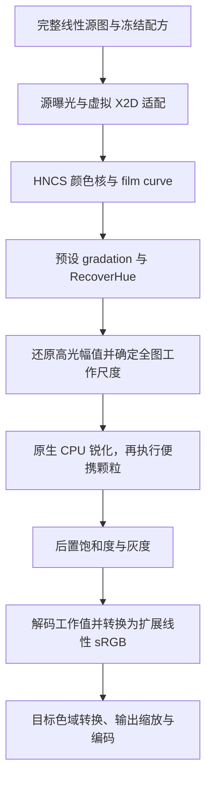

# HNCS

HNCS 将已解码的源照片转换为所选 Hasselblad 工作空间中的颜色、明暗和细节效果，再交回图像管线生成成片。`CHNCS` 实现数值处理，`HNCSEngine` 管理配方、原生上下文和工作文件；RAW 解码与最终编码由 `ImagePipeline` 负责。

## 工作方式

### 照片白平衡与预设白平衡

Apple RAW 解码器先完成源照片的白平衡。`PhotoWhiteBalance` 保存解码器的温度、Tint 和完整 xy 白点；HNCS 用 xy 构造虚拟 X2D 拍摄增益基线，色温只用于工厂矩阵与 LUT 的选择。处理配方绑定白点后，重试和导出沿用该值。

`whiteBalancePolicy` 决定预设是否替换照片的白平衡：

| 策略 | 目标增益 | 默认工厂色温 |
|---|---|---|
| `photo`（Photo · Automatic） | 等于照片的虚拟拍摄增益，保留现场白平衡 | 从照片 xy 得到的 CCT |
| `preset`（Original preset） | 使用预设的固定目标增益；预设没有固定值时保留拍摄增益 | 预设色温；没有固定值时使用照片 CCT |

`factoryKelvinOverride` 只覆盖工厂矩阵与 LUT 的插值色温，范围为 2000–10000 K。捕获白点、目标增益和工厂色温分别保存；适配器使用目标相对于拍摄基线的调整，避免对已白平衡的 RGB 再施加整份目标增益。没有照片白点的旧参考调用使用保留的 CCT 入口。

Nature 的原始白平衡为 5500 K 和 Phocus Tint `−0.003333333333333333`，主曲线控制点为 `(0,0)、(71,31)、(184,223)、(255,255)`。选择 `photo` 保留这条明暗曲线及其他参数，只让白平衡跟随照片；这也适用于 Daylight、Cloudy 等带固定白平衡的预设。Apple Tint 与 Phocus Tint 使用不同单位，完整 xy 保留绿／洋红方向的信息。

### 颜色与空间阶段

新建配方使用 `pipelineRevision = 2`、HNCS `renderRevision = 12`。完整源导出在裁剪后、下采样前完成整条处理：



颜色核将虚拟原生 RGB 量化为 UInt16，经输入矩阵得到亮度和归一化色度，再对二维绝对色度 LUT 作双线性插值。灰度与暗部权重调节色度，以 Y 为重建基线形成工作 RGB，最后查所选 film curve。`standard` 与 `reproduction` 使用各自的工厂配置；`legacy` 与 `lstar` 分别选择 Hasselblad RGB 与 Hasselblad L*RGB 的工作原色和传递函数。

`asShot` 是曲线选择哨兵。Apple 输入没有 Phocus FilmCurve 元数据，因此明确以 `rawFilmCurveType = 2` 解析为 Standard；其他选择为 Old Standard（0）、High Contrast（1）、Standard（2）、Low Contrast（6）和 Linear（7）。`reproduction` 始终解析为 type 7；Old Standard 只在 legacy 工作空间中有独立曲线。预设 gradation 在没有用户曲线调整时仍执行原表和 RecoverHue；关闭 `applyToneCurve` 只跳过 Points 对应的曲线，Gamma 和 contrast 阶段继续执行。

原生锐化使用预设参数、完整分辨率像素尺度、复制边缘和 RAW 的 `BaselineSharpness`，缺失该元数据时取 0。HNCS 输入关闭 Apple 解码器锐化，防止重复施加细节处理。只含单个工具的预设叠加原厂 Standard 参数，因此 Standard 和工具预设也可能启用原生锐化。

颗粒采用保留的便携模型：预设键与裁剪后整图尺寸决定 SHA-256／PCG64 随机流，随后执行 wrap Gaussian 和全图 Float32 统计。工作文件按自上而下的 RGB Float32 行序读写；分条只改变 I/O 大小，空间处理始终看到同一张完整工作图。取消或错误时丢弃部分结果，工作文件所有者释放暂存文件。

### HDR 工作域

revision 12 接收完整扩展线性源值。每像素以 `g = max(1, R, G, B)` 得到有界颜色输入；颜色核和 gradation 后，在工作空间恢复幅值：

```text
w = encode_working(decode_working(code / 65535) × g)
```

`g = 1` 时直接保留原 Float32 工作值，避免多余的传递函数往返。legacy 工作空间使用原 ICC gamma，L*RGB 使用 L* 定义；`w` 是可超过 1 的编码工作值。

扫描整张裁剪后工作图的最大分量 `maximum`，选取唯一尺度：

```text
S = 1                              maximum ≤ 1
S = max(5.8829245141, maximum)      maximum > 1
```

有限工作值和尺度的上限均为 64。空间入口按 `S` 将整图打包到 `[0,1]`；原生锐化的 amount／noise 表采用相同尺度，使参考白以上的明暗差进入亮度、模糊和阈值计算。颗粒幅度按参考白定义，打包时除以 `S`。即使关闭颗粒与锐化，也要完成这次全图打包。

结束阶段使用绑定了同一 `S` 的不可变上下文，将后置颜色结果解码回工作线性值，再转换为带符号的 extended-linear-sRGB。负分量和超过 1 的分量保留到目标色域转换；末端在线性 BT.2020 中执行范围处理和 PQ 编码。revision 12 不另存逐像素 gain 图，也不在锐化后再次乘回旧 gain。

revision 11 仍沿用旧 HDR 适配：先分离每像素高光幅值，在有界图像完成颜色与空间阶段，再恢复幅值；旧 SDR 显示转换保留 sRGB 限幅。它和 revision 12 由配方版本明确选择。

### 效果开关与缓存

`EffectToggles` 中颗粒、锐化、额外裁剪独立保存，默认均为 `true`。打开开关只启用预设已有的阶段，不修改预设参数；颗粒以 catalog 标志判断，锐化以 `hncs_native_sharpness_enabled` 判断，不能套用旧便携 USM 的标志决定原生锐化。

额外裁剪只作用于 HNCS 的 `square-crop`：取源图短边并整数居中，奇数余量留在右侧或下侧。历史照片保留这项行为；相机预设目录排除 `square-crop`，已保存的相机偏好将其迁为 `standard`。

上下文缓存身份包含曝光、捕获色温、完整白点、全部 HNCS 设置、效果开关与 `workScale`。缓存替换后，正在执行的调用仍持有原上下文；成片回看和完整源导出传入同一冻结配方。

## 不变量

1. 新建 HNCS 使用 `standard`、`asShot`、`rawFilmCurveType = 2` 和空工厂色温覆盖。— `ImagingCoreTests/RecipeTests.newHNCS_defaultsUseStandardAsShotAndNativeFilmCurve`
2. 照片白点只绑定一次，经过配方编解码后保持原值。— `ImagingCoreTests/WhiteBalanceTests.automaticWhiteBalance_bindsPhotoOnceAndSurvivesCodable`
3. Nature 的 `preset` 策略保留旧白平衡输出，`photo` 策略在固定长焦灰色夹具上保持近中性且不受策略切换污染。— `ImagingCoreTests/WhiteBalanceTests.presetNature_replaysOriginalTelephotoWhiteBalance`、`photoNature_keepsTelephotoGrayNeutralAcrossPolicyChanges`
4. pipeline revision 2 的曝光等价于先对完整线性源图施加曝光，旧管线按冻结曝光 golden 重放。— `ImagingCoreTests/ColorChainTests.exposure_matchesScalingSceneLinearSource`、`unversionedRecipe_replaysFrozenExposureGolden`
5. 原生工作值、锐化和后置颜色依次匹配冻结的 Phocus 向量。— `tests/numeric/test_phocus_native_chain.py::NativePhocusChainTests::test_original_binary_work_sharpness_and_final_codes`
6. revision 12 在空间处理前保留高光幅值，并让锐化作用于参考白以上的中性细节。— `tests/numeric/test_hncs_hdr_domain.py::HNCSHDRDomainTests::test_hdr_magnitude_is_present_before_spatial_processing`、`ImagingCoreTests/ImagePipelineTests.hdrSpatialProcessing_sharpensNeutralHighlightDetail`
7. 工作原色转换保留扩展 sRGB 的负分量与超单位值。— `tests/numeric/test_hncs_hdr_domain.py::HNCSHDRDomainTests::test_working_primaries_survive_as_signed_extended_srgb`
8. 全图共用尺度时，分条、内存与文件路径结果一致；非法尺度或未绑定相同尺度的结束调用失败。— `tests/numeric/test_hncs_hdr_domain.py::HNCSHDRDomainTests::test_one_frame_scale_matches_all_strip_partitions_and_file_storage`、`test_invalid_scale_and_missing_scale_binding_are_rejected`
9. 显式 `effects` 优先于旧 HNCS 标志，缺失的旧标志独立默认，只有活动 HNCS 方形预设执行额外裁剪。— `ImagingCoreTests/RecipeTests.explicitEffects_overrideLegacyFlagsAndRoundtrip`、`missingLegacyFlag_defaultsWithoutErasingExplicitFalse`、`extraCrop_onlyAffectsActiveHNCSSquarePreset`
10. 给没有颗粒的 Standard 打开颗粒开关，像素与原预设参数保持不变。— `ImagingCoreTests/CropGeometryTests.enablingAbsentGrain_preservesStandardPixelsAndPreset`
11. 配方变化区分缓存身份，替换缓存不使既有原生上下文失效。— `ImagingCoreTests/ContextCacheTests.hncsChangedRequest_keepsAllRequestedSettings`、`replacedHNCSEntry_keepsInFlightNativeOwnerUsable`
12. 旧照片保留预设白平衡和选择，未来拍摄的相机偏好独立迁移。— `CaptureTests/RecipeMigrationTests.oldPhoto_keepsPresetWhiteBalanceAndSelections`、`oldCameraPreferences_adoptPhotoWhiteBalanceIndependently`
13. 完整源空间导出和整图处理得到相同成片，分条大小不改变工作文件的空间处理结果。— `ImagingCoreTests/ColorChainTests.spatialStripExport_matchesWholeImageAndDirectBytes`、`ImagePipelineTests.spatialWorkFile_matchesNativeMemoryPath`

## 数据与版本

### 配方兼容

HNCS 的 `renderRevision` 与共享 `pipelineRevision`、上游资产版本分别保存。共享管线版本决定曝光与输入规则，HNCS 版本决定工作域；省略 `pipelineRevision` 的配方按版本 1 读取。当前 HNCS 有效版本是 11、12，其他未知值通过 `isValid` 拒绝。

| 保存的 HNCS 值 | 当前解码与处理含义 |
|---|---|
| `renderRevision = 12` | 使用扩展工作域与全图尺度；新建设置默认 `whiteBalancePolicy = photo` |
| `renderRevision = 11` | 保留旧高光分离／恢复与输出限幅；显式白平衡策略继续生效 |
| `renderRevision = 8、9、10` | 解码统一为 11，保留预设、曲线、工作空间等选择，不分派到各自的历史算法 |
| 存在 `hncs` 对象，但缺失版本或白平衡策略 | 版本默认为 11；缺失的策略默认为 `preset` |
| 整个 `hncs` 缺失或为 null | 使用 `legacyStandard`：版本 11，其余为新设置的默认值，包含 `photo` 策略 |

相机偏好只为未来拍摄升级到版本 12；旧值未明确选择白平衡策略时采用 `photo`，显式 `photo`／`preset` 均保留。已保存照片按自身配方恢复，已编码的待保存成片直接复用文件。设置仍沿用 `editor.processingRecipe.revision8.v1` 键。

旧配方没有 `effects` 时，仅活动 HNCS 模式继承 `hncs.applyGrain` 和 `hncs.applySharpness`，缺失项各自默认 `true`，额外裁剪默认 `true`。有显式 `effects` 时以它为准，重新编码不再重复输出这两个旧 HNCS 字段。

### 工厂资产与原生接口

选取的上游交付固定为 colour revision 2、render revision 8；来源、提交和校验清单见 [HNCS 来源](../../vendor/hncs/ORIGIN.md)。原始矩阵、色度 LUT、ICC、预设 JSON、曲线表及上游说明保留在 [vendor/hncs](../../vendor/hncs/)，构建使用 `CHNCS/generated/` 中的静态资产。应用版本 12 没有改写上游交付的版本号。

预设 catalog 保存原厂 XML 对应的参数和别名，界面只展示 Standard 或具有实际效果的条目。原版六张 UInt16 曲线表保留 65536 项精度；Standard 也执行 gradation。便携 revision-8 的逐点／空间 C ABI 为参考兼容保留，应用照片路径使用颜色／空间／后置颜色分段接口。

`hncs_clone_with_native_gain` 为已准备好的原生输入调整暗部色度阈值，保留原生乘法顺序；该增益不再乘到像素曝光上。另有 `hncs_render_x2d_hdr_color`、`hncs_render_x2d_hdr_post`、`hncs_apply_x2d_hdr_gradation` 和 `hncs_render_x2d_hdr_sharpness`，面向已准备好的 X2D HDR 数据。颜色入口支持 Standard film curve、普通颜色模型及 `[0.25,32]` 的处理增益，HDR gradation／锐化只覆盖列入资产的 Standard、Nature 配置。

数值测试读取 [HNCS 冻结夹具](../../tests/fixtures/hncs/README.md) 和保留的参考资产。原生链、处理增益及 X2D HDR 的预期值由 Phocus 原程序产生，来源和向量摘要随夹具保存；测试不现场重采集预期值。生成与原厂调查工具位于 `GlassCam-research`，产品运行只使用保留资产。

C++ 内核保留 `-fno-fast-math -ffp-contract=off`；Float32、Double、显式 FMA、截断和 ties-to-even 各按对应阶段执行。并行分块复用相同算术，数值改动须通过相应 golden 比对。

## 已知限制

- Apple→虚拟 X2D 是源域适配模型，尚无受控相机对拍标定，色彩数值一致性只覆盖相同输入与约定阶段。
- 便携颗粒使用参考随机模型，未实现 Phocus 原生颗粒核；缩小图像的尺寸与统计不同，颗粒图样可能与完整源成片不同。
- 原生锐化实现完整分辨率的 CPU 分支，未覆盖局部调整、镜头锐化补偿或原厂缩小图像半径补偿。
- X2D 专用 HDR 接口要求原生准备输入，Apple 照片路径未接入完整 X2D RAW 校准、降噪、去马赛克、高光重建及原厂 HDR limit／ICC 链。
- 任意自定义 HDR 曲线、局部图层、选择性颜色与 vibrance 不在现有工厂预设实现范围内。
- revision 12 即使关闭空间效果也需要完整工作文件，临时存储需求随源图尺寸增长。
- HNCS 没有开放带照片白点的实时色彩代理，拍摄时显示系统取景画面。

## 代码入口

- [HNCSSettings.swift](../../Packages/GlassCamKit/Sources/ImagingCore/Model/HNCSSettings.swift)、[ProcessingRecipe.swift](../../Packages/GlassCamKit/Sources/ImagingCore/Model/ProcessingRecipe.swift)：版本、设置、效果和旧数据解码。
- [HNCSPresetCatalog.swift](../../Packages/GlassCamKit/Sources/ImagingCore/Model/HNCSPresetCatalog.swift)、[PhotoWhiteBalance.swift](../../Packages/GlassCamKit/Sources/ImagingCore/Model/PhotoWhiteBalance.swift)：预设目录与完整照片白点。
- [HNCSEngine.swift](../../Packages/GlassCamKit/Sources/ImagingCore/Engines/HNCSEngine.swift)、[HNCSPresetWorkFile.swift](../../Packages/GlassCamKit/Sources/ImagingCore/Engines/HNCSPresetWorkFile.swift)：上下文、Swift／C 桥和工作文件所有权。
- [hncs.cpp](../../Packages/GlassCamKit/Sources/CHNCS/hncs.cpp)、[hncs_c.h](../../Packages/GlassCamKit/Sources/CHNCS/include/hncs_c.h)：颜色核、白平衡适配、曲线、HDR 工作域及 C ABI。
- [hncs_spatial.cpp](../../Packages/GlassCamKit/Sources/CHNCS/hncs_spatial.cpp)、[hncs_spatial.h](../../Packages/GlassCamKit/Sources/CHNCS/include/hncs_spatial.h)：原生锐化、便携颗粒、全图尺度与取消。
- [ImagePipeline+Rendering.swift](../../Packages/GlassCamKit/Sources/ImagingCore/Processing/ImagePipeline+Rendering.swift)、[ImagePipeline+Export.swift](../../Packages/GlassCamKit/Sources/ImagingCore/Processing/ImagePipeline+Export.swift)：冻结配方处理及完整源分条导出。
